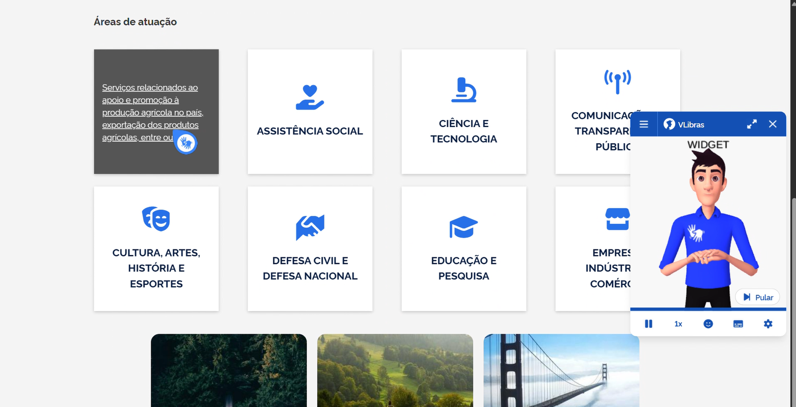
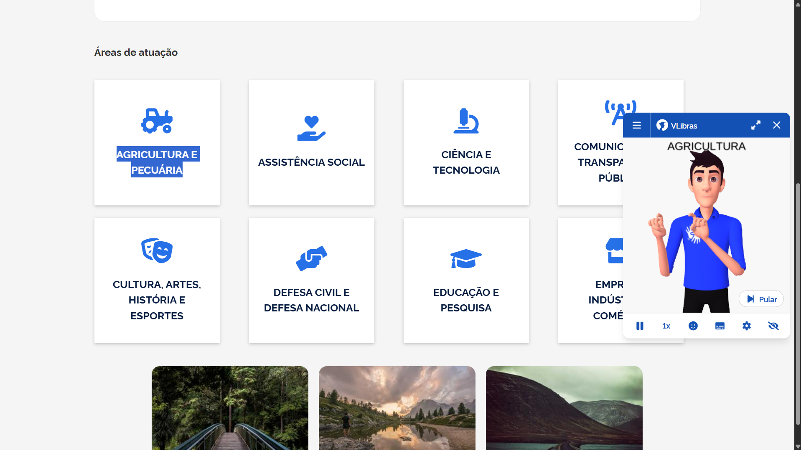
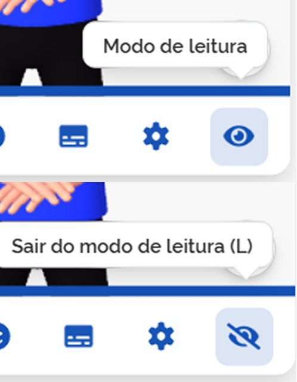

# Proposta de Solução

Esta página descreve a solução escolhida na [matriz de priorização](./problemas-e-oportunidades.md), o **cursor dedicado à seleção e tradução**, e a primeira implementação feita pela equipe: um **modo de leitura**, acionado por botão, em que o cursor do widget deixa de disparar os *hovers* da página. Ela também reúne as evidências do comportamento antes e depois da alteração.

## 1. Problema que a solução endereça

Na [MI3.2](../fase-4/capacidade-de-interacao/mi3-2-eficancia-selecao-texto.md), **4 de 7 tentativas de seleção falharam** (taxa de sucesso de 42,9%, faixa Ruim), e nenhuma das quatro tarefas em portais teve sucesso. A tarefa **S6** (card de categorias no portal gov.br) é o caso central desta proposta: o título do card não pôde ser lido, porque a descrição aparece ao passar o mouse sobre ele, e o widget lê a descrição em vez do título.

**Causa técnica.** O widget original captura o texto por clique, em que um listener em `document.body` (`text-capture`) traduz a seleção ou o texto do elemento clicado. Para chegar ao texto, o ponteiro precisa estar sobre o elemento, e é justamente isso que ativa o `:hover` da página. O widget não controla o CSS nem os scripts da página hospedeira, portanto não pode remover esses *hovers* na origem.

**Tabela 1.** Falhas da MI3.2 e relação com esta solução.

| Tarefa | Elemento                       | Causa registrada                                                       | Endereçada por esta implementação?                                                                         |
| ------ | ------------------------------ | ---------------------------------------------------------------------- | ---------------------------------------------------------------------------------------------------------- |
| S4     | Carrossel (CGU)                | O gesto de arrastar move o carrossel; a leitura só funciona por clique | Esperado que sim, visto que ponteiro fica sobre a camada do widget, então o arrasto não chega ao carrossel |
| S5     | Card de rede social (*iframe*) | Texto dentro de *iframe* não pode ser selecionado                      | Não. O navegador isola o conteúdo do *iframe*                                                              |
| S6     | Card de categorias (gov.br)    | O *hover* exibe a descrição no lugar do título                         | Sim, é o caso-alvo                                                                                         |
| S7     | Botão (Ministério da Saúde)    | O botão é lido, mas o texto dele não pode ser selecionado              | Esperado que sim, pois a seleção é feita pela posição do ponteiro, sem clicar no botão                     |

Fonte: elaborado pelos autores, a partir da MI3.2.

## 2. Solução proposta

A solução candidata, descrita em [Problemas e Oportunidades](./problemas-e-oportunidades.md), é acionar por botão um modo dedicado à leitura e tradução, em que o cursor do widget não dispara os *hovers* da página. O conteúdo que só aparece ou só é substituído quando o mouse passa por cima deixa de mudar enquanto a pessoa seleciona o texto.

### 2.1. O que foi implementado

- Um botão no widget que liga e desliga o modo de leitura, com o estado exposto por `aria-pressed`.
- No modo de leitura, o ponteiro nunca está sobre um elemento da página, então nenhum `:hover` é disparado e o texto original (por exemplo, o título do card) permanece visível.
- A seleção e a tradução continuam funcionando, feitas pelo próprio widget.
- Ao desligar o modo, a página volta ao comportamento normal.

### 2.2. Como funciona

O estado `:hover` do CSS não pode ser bloqueado interceptando eventos de JavaScript: ele só deixa de ocorrer se o ponteiro não estiver sobre o elemento. Por isso a solução não toca nos elementos da página. Ela coloca uma camada por cima deles:

1. **Estado global.** O store do widget ganhou o campo `cursorMode` (`"navigate"` ou `"read"`) e as ações `setCursorMode` e `toggleCursorMode`. O campo não é persistido, pois o widget sempre inicia em `navigate`, para que ninguém abra um site com a página sem reagir ao mouse.
2. **Camada transparente.** No modo `read`, o componente `ReadingOverlay` renderiza um `div` com `position: fixed`, cobrindo toda a janela e com `z-index` logo abaixo do painel do widget, que continua clicável. Como o navegador entende que o mouse está sobre essa camada, nenhum elemento da página recebe `:hover`, `mouseover` ou `mouseenter`. A camada é irmã do contêiner arrastável do widget, e não filha dele, porque o `transform` aplicado ao arrastar a janela alteraria a referência do `position: fixed`.
3. **Seleção própria.** Como a camada impede a seleção nativa, o widget faz a seleção com a Selection API. Ao pressionar o botão do mouse, ele descobre o ponto de texto sob o ponteiro com `caretPositionFromPoint` (ou `caretRangeFromPoint`, em navegadores mais antigos), desligando `pointer-events` da camada só durante essa consulta, que é síncrona. Ao arrastar, ele estende a seleção com `setBaseAndExtent`. O duplo clique seleciona a palavra com `Selection.modify`.
4. **Tradução.** Ao soltar o mouse (ou concluir o duplo clique), o widget executa a mesma sequência do fluxo normal: `stop`, tradução, `resetCallback` e `play`. O `text-capture` passou a ignorar cliques enquanto `cursorMode` for `read`, para que a seleção não seja traduzida duas vezes.
5. **Saída do modo.** O modo termina pelo botão, pela tecla **L** ou ao fechar o painel do widget.
6. **Extensão.** O modo não é ativado na versão de extensão (`__IS_EXTENSION__`), cujo painel ocupa a tela inteira e tem comportamento próprio.

**Código:** [Repositório](https://github.com/FCTE-Qualidade-de-Software-1/2026-2_T02_ROBERTA_WILLIAMS.git), branch `feat/vlibras-proposta-melhoria`, commit `c860c722aa88f9cfb203cdde10cccfdfada0811c`.

**Tabela 2.** Principais arquivos alterados.

| Arquivo                                                      | Alteração                                                                             |
| ------------------------------------------------------------ | ------------------------------------------------------------------------------------- |
| `src/widget/stores/use-widget.store.ts`                      | Campo `cursorMode` e ações `setCursorMode` e `toggleCursorMode`, fora do `partialize` |
| `src/widget/components/reading-overlay/index.tsx` (novo)     | Camada transparente, seleção por ponteiro, duplo clique, saída por L e tradução       |
| `src/widget/utils/text-capture/index.ts`                     | O `handleClick` retorna cedo quando `cursorMode === "read"`                           |
| `src/widget/app.tsx`                                         | Monta o `ReadingOverlay` fora do `Draggable` e volta a `navigate` ao fechar o painel  |
| `src/widget/components/reading-mode-button/index.tsx` (novo) | Botão de alternância do modo, com `aria-pressed`                                      |

## 3. Evidências: antes e depois

### 3.1. Como a comparação foi feita

O "antes" é o resultado já registrado na [MI3.2](../fase-4/capacidade-de-interacao/mi3-2-eficancia-selecao-texto.md), com a participante P01, em 18/11/2026, no widget publicado 7.12.2. O "depois" foi obtido com a versão alterada, compilada a partir do commit `c860c722aa88f9cfb203cdde10cccfdfada0811c`, em uma página de teste que possui elementos de card com o mesmo comportamento registrado nos cards do portal Gov.br, nos navegadores Opera GX 139 e Chrome 157, por Ludmila O. Nunes, em 23/11/2026.

Como as duas medições têm avaliadores diferentes, a comparação mostra se o comportamento mudou, mas não mede o efeito da solução. Em razão da complexidade da reprodução fiel dos elementos em uma página de teste, foi reproduzida apenas uma réplica do componente de card, que está originalmente presente do Portal Gov.br.

### 3.2. Resultados encontrados

**Tabela 3.** Repetição da tarefa S6 (caso-alvo).

| Widget               | Título lido e selecionado? | Descrição exibida no lugar do título? |
| -------------------- | -------------------------- | ------------------------------------- |
| Original             | Não                        | Sim                                   |
| Alterado, modo ativo | Sim                        | Não                                   |

### 3.3. Evidências visuais

**Figura 1.** Antes: ao passar o cursor sobre o card, a descrição substitui o título, e o widget lê a descrição (tarefa S6). Fonte: elaborado pelos autores.

**Figura 2.** Depois: com o modo ativo, o card não reage ao cursor, e o título permanece visível e selecionável. Fonte: elaborado pelos autores.

**Figura 3.** Botão do modo de leitura nos estados desligado e ligado. Fonte: elaborado pelos autores.

**Vídeo comparativo.**

Inserir iframe

## 4. Efeito esperado e alcance

- **Efeito direto:** a tarefa S6 deve passar a ter sucesso, o que elevaria a taxa de 3 de 7 para 4 de 7, 57,1%, ainda na faixa Ruim (< 70%). A solução, sozinha, não leva a MI3.2 à faixa Satisfatória se apenas S6 for resolvida, mas representa uma solução importante para uma barreira de navegação existente.
- **Fora do alcance:** conteúdo dentro de *iframes* cross-origin (S5) continua limitado pelas regras do navegador, e a consulta de posição de texto retorna o próprio *iframe*.

## 5. Riscos e efeitos colaterais

- **Página sem reação ao mouse.** Enquanto o modo está ativo, a camada intercepta todos os cliques: links, menus e botões da página não respondem. É o comportamento pretendido, mas exige saída fácil. Por isso o modo não é persistido, encerra com **L** e é desligado ao fechar o painel.
- **Menus que só abrem com *hover*.** Ficam inacessíveis com o modo ativo; a pessoa precisa abri-los no modo de navegação e, se o conteúdo permanecer visível, ativar o modo de leitura em seguida.
- **Rolagem.** A roda do mouse sobre a camada rola o documento, mas pode não rolar contêineres internos com `overflow`. Não verificado.
- **Vazamento de *hover* na consulta de posição.** A camada é desativada por um instante para descobrir o texto sob o ponteiro. Em teoria o navegador não recalcula o *hover* nesse intervalo, mas navegadores baseados em Chromium podem emitir movimentos sintéticos do mouse. Não verificado.
- **Shadow DOM da página.** A consulta de posição tem suporte limitado a textos dentro de *shadow roots* da página hospedeira, principalmente no Chrome.
- **Estado do foco do teclado.** Efeitos que dependem de foco, e não de *hover*, não são afetados.
- **Compatibilidade.** Testado em Chrome 157 e Opera GX 139. A seleção por toque no celular não foi avaliada, e os problemas conhecidos de Safari e Chrome móvel (MF1.1) podem afetar a solução.

## 6. Limitações da verificação

- O "depois" foi medido pela equipe, e não por pessoas surdas nem pela participante da MI3.2. O resultado mostra que o comportamento mudou, e não que a experiência do público-alvo melhorou.
- Os conteúdos dinâmicos não foram avaliados aqui.
- Não foram medidos desempenho nem acessibilidade do widget alterado.

## 7. Próximos passos

1. Repetir a MI3.2 completa com o widget alterado e participantes surdos, que são o público prioritário.
2. Tratar o carrossel (S4) e o botão (S7), caso o teste mostre que não foram resolvidos, com teste de regressão nas tarefas S1 a S3.
3. Avaliar rolagem de contêineres internos e a seleção por toque em dispositivos móveis.
4. Avaliar a segunda parte da proposta, mensagens de erro e status acessíveis.

## Participação

| Integrante       | Contribuição                                                                                  |
| ---------------- | --------------------------------------------------------------------------------------------- |
| Ludmila O. Nunes | Implementação do botão e do modo sem *hover*, testes antes e depois e registro das evidências |

## Referências

> RAMOS, Cristiane Soares. **Aula A07: Processo de Avaliação de Produto**. Slides da disciplina Qualidade de Software 1. Brasília: Universidade de Brasília, 2026.

## Histórico de Versões

| Versão | Data       | Descrição da alteração                                                                                                                | Autor(a)         | Revisor(a) |
| ------ | ---------- | ------------------------------------------------------------------------------------------------------------------------------------- | ---------------- | ---------- |
| 0.1    | 23/11/2026 | Descrição da proposta, implementação e evidências antes e depois, além da descrição técnica do mecanismo, arquivos alterados e riscos | Ludmila O. Nunes |            |