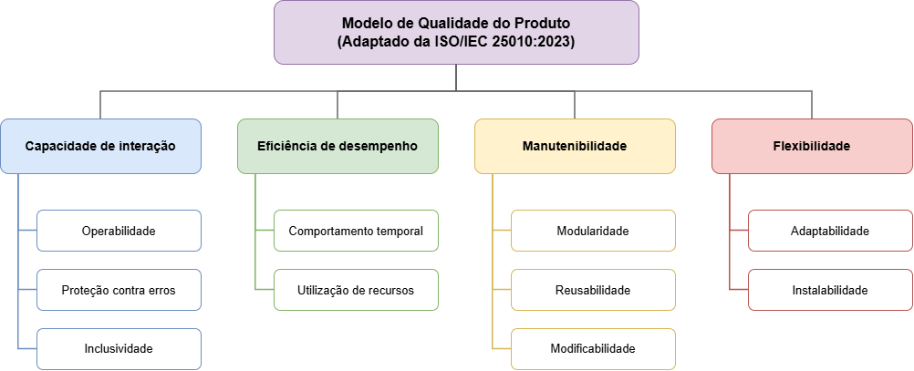

# Modelo de qualidade

## Modelo de referência

Como referência, foi utilizado o modelo de qualidade do produto da **ISO/IEC 25010:2023** (ISO/IEC, 2023). Ele tem nove características: 
- adequação funcional
- eficiência de desempenho
- compatibilidade
- capacidade de interação
- confiabilidade
- segurança
- manutenibilidade
- flexibilidade
- segurança operacional

Dessas, optamos por realizar um recorte com quatro delas: **capacidade de interação, eficiência de desempenho, manutenibilidade e flexibilidade**.

## Características adotadas

Escolhemos cada característica por uma parte interessada e pelas decisões que ela apoia, descritas no [Propósito](./proposito-da-avaliacao.md).

**Tabela 1.** Características adotadas e o contexto que as justifica.

| Característica           | Parte interessada                                                     | Contexto                                                                                                                                         | Decisões |
| ------------------------ | --------------------------------------------------------------------- | ------------------------------------------------------------------------------------------------------------------------------------------------ | -------- |
| Capacidade de interação  | Usuários com deficiência auditiva                                     | Parte do público não é alfabetizada em português e depende de recursos visuais para navegar, escolher textos e entender alertas                  | D1 e D2  |
| Eficiência de desempenho | Usuários com deficiência auditiva                                     | Em hardware limitado ou internet lenta, respostas demoradas e travamentos do avatar frustram o usuário                                           | D3       |
| Manutenibilidade         | Equipe de desenvolvimento e manutenção                                | Navegadores e plataformas do Governo Federal mudam com frequência, e uma arquitetura padronizada, com o Design System, reduz o tempo de correção | D4       |
| Flexibilidade            | Equipe de desenvolvimento e manutenção e desenvolvedores integradores | Há muitos dispositivos, sistemas e navegadores, e o widget precisa entrar em vários portais com poucas adaptações                                | D5 e D6  |

## Subcaracterísticas

Em cada característica, ficaram as subcaracterísticas ligadas às decisões e aos objetivos de melhoria elencados anteriormente.

**Tabela 2.** Subcaracterísticas mantidas, com a decisão ou o objetivo que apoiam, e as que ficaram fora.

| Característica           | Mantidas (decisão ou objetivo)                                                                                                      | Fora do recorte                                                                                                      |
| ------------------------ | ----------------------------------------------------------------------------------------------------------------------------------- | -------------------------------------------------------------------------------------------------------------------- |
| Capacidade de interação  | Operabilidade (D1 e D2); proteção contra erros do usuário (D1); inclusividade, pela diferenciação visual (D1) e pelo contraste (D2) | Reconhecibilidade de adequação, aprendibilidade, engajamento do usuário, autodescritividade e assistência ao usuário |
| Eficiência de desempenho | Comportamento temporal e utilização de recursos (D3)                                                                                | Capacidade                                                                                                           |
| Manutenibilidade         | Modularidade (baixo acoplamento), reusabilidade (D4) e modificabilidade (alterações de interface)                                   | Analisabilidade e testabilidade                                                                                      |
| Flexibilidade            | Adaptabilidade (D5) e instalabilidade (D6)                                                                                          | Escalabilidade e substituibilidade                                                                                   |

## Características não adotadas

**Tabela 3.** Características fora da avaliação e o motivo.

| Característica        | Motivo                                                                                                                                           |
| --------------------- | ------------------------------------------------------------------------------------------------------------------------------------------------ |
| Adequação funcional   | Fora do propósito. Avaliar a correção das traduções exigiria linguistas; no VLibras, são eles que revisam as traduções, pelo fluxo do WikiLibras |
| Compatibilidade       | Os conflitos com o site que hospeda o widget já entram em Flexibilidade, na integração do widget aos portais (D6)                                |
| Confiabilidade        | Disponibilidade e tolerância a falhas dependem dos serviços remotos, que ficam fora do repositório e do nosso alcance                            |
| Segurança             | Avaliar segurança exigiria testes de invasão nos serviços de produção, para os quais a equipe não tem autorização                                |
| Segurança operacional | O produto traduz texto para Libras e não controla equipamentos nem processos que possam causar dano físico, ambiental ou à vida                  |

## Representação gráfica

**Figura 1.** Adaptação do modelo de qualidade do produto. Fonte: Elaborado pelos autores.

## Referências

> ISO/IEC. **ISO/IEC 25010:2023**: systems and software engineering: systems and software quality requirements and evaluation (SQuaRE): product quality model. 2. ed. Geneva: ISO/IEC, 2023.

## Histórico de Versões

| Versão | Data       | Descrição da alteração                                                                                                 | Autor(a)       | Revisor(a) |
| ------ | ---------- | ---------------------------------------------------------------------------------------------------------------------- | -------------- | ---------- |
| 1.0    | 24/10/2026 | Inserção do modelo de referência, das características e subcaracterísticas adotadas e das características não adotadas | Amanda C. Lima |            |
