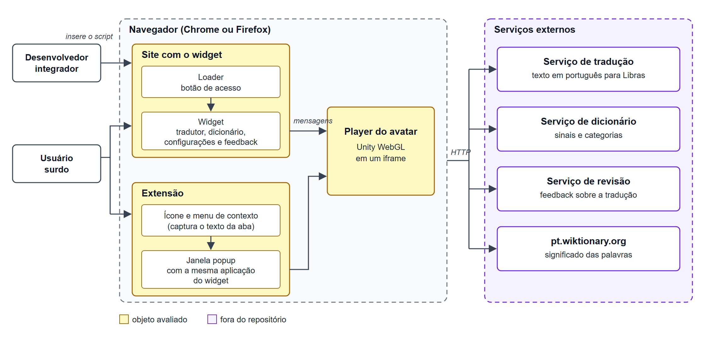

# Tipo de produto e descrição estruturada do software

## Identificação do produto

O VLibras Web Browsers reúne duas formas de uso da mesma aplicação: o widget, que os sites incorporam, e a extensão, que o usuário instala no navegador. Ele roda no navegador, mas a tradução é feita por serviços remotos.

**Tabela 1.** Identificação do produto avaliado.

| Item | Descrição |
| ---- | --------- |
| Nome | VLibras Web Browsers: VLibras Widget e VLibras Plugins (extensões) |
| Responsável | Suíte VLibras, desenvolvida pelo Ministério da Gestão e da Inovação em Serviços Públicos, pelo Ministério dos Direitos Humanos e da Cidadania e pelo LAVID/UFPB |
| Repositório | [vlibras-web-browsers](https://github.com/spbgovbr-vlibras/vlibras-web-browsers) |
| Versão | 7.12.2, de 04/09/2026 |
| Domínio de aplicação | Acessibilidade: tradução de texto em português para Libras, mostrada em um avatar 3D |

## Tipo de produto

A classificação usa os critérios de domínio, modelo de negócio, características construtivas e disponibilidade de dados, além das categorias de Pressman e da IEEE 1062.

**Tabela 2.** Classificação do VLibras Web.

| Critério | Classificação |
| -------- | ------------- |
| Categoria (Pressman) | Software de inteligência artificial: a página oficial descreve uma tradução automática, com frases treinadas por inteligência artificial |
| Categoria (IEEE 1062) | COTS: um único produto, usado por muitos sites e usuários |
| Modelo de negócio | Gratuito e de código aberto, com licença LGPL-3.0-or-later |
| Características construtivas | Aplicação web cliente que consome serviços remotos, entregue como widget para sites e como extensão para Chrome e Firefox |
| Disponibilidade de dados | Código-fonte público; os serviços de tradução e de dicionário só são acessíveis como cliente |

## Descrição geral

Aqui estão o que o produto faz, para quem, em que contexto e quais tarefas vamos avaliar.

**Tabela 3.** Descrição geral do produto.

| Item | Descrição |
| ---- | --------- |
| Funções | 6 telas e diálogos (Tradutor, Dicionário, Configurações, Feedback, Guia Rápido e Sobre) e os controles do player. O "Guia Rápido" só existe no widget |
| Tarefa principal | Traduzir para Libras o texto de páginas web, com a tradução exibida em um avatar 3D |
| Tarefas avaliadas | Selecionar texto e traduzir, identificar o que pode ser traduzido (hover), repetir, mudar a velocidade, escolher o regionalismo, consultar o dicionário, entender alertas de erro e integrar o widget a um portal |
| Usuários | Pessoas com deficiência auditiva, em geral não alfabetizadas ou com pouca fluência em português, e desenvolvedores que integram o widget |
| Conhecimento exigido | De leigo a avançado em informática. Também não deve exigir leitura em português escrito |
| Ambiente de uso | Páginas de serviços digitais do Governo Federal e outros sites, em dispositivos móveis e desktop |
| Hardware e software | Navegador Chrome ou Firefox, os indicados no repositório, com WebGL e WebAssembly e acesso à internet |
| Massa de dados | Textos em português e páginas de portais do Governo Federal |

## Módulos

O código está dividido em módulos. A extensão reaproveita a aplicação do widget, e a tradução em si fica em serviços fora do repositório. A última coluna indica o que a equipe avalia.

**Tabela 4.** Módulos do VLibras Web e componentes avaliados.

| Módulo | Função | Avaliado? |
| ------ | ------ | --------- |
| Loader | Cria o botão de acesso na página e carrega o widget | Sim, pelo funcionamento e pelo código-fonte |
| Widget | Interface em Preact: tradutor, dicionário, configurações, feedback e captura de texto da página | Sim, pelo funcionamento e pelo código-fonte |
| Player | Avatar 3D (Unity WebGL) em um iframe, controlado por mensagens: reproduzir, pausar, repetir, velocidade, legendas, emoções, avatar e regionalismo | Sim, pelo funcionamento; o repositório só traz os binários do Unity, sem o código-fonte |
| Core e Common | Configuração dos serviços, requisições, estado e utilitários compartilhados | Sim, pelo código-fonte |
| Extensão | Janela popup com a mesma aplicação do widget e script que captura o texto das abas | Sim, pelo funcionamento no Chrome e no Firefox e pelo código-fonte |
| Serviços remotos | Tradução, dicionário, repositório de sinais e revisão, fora do repositório | Não, só o que o navegador enxerga, como o tempo de resposta |
| Aplicativos nativos | Fora do repositório | Não, fora do escopo definido no artigo |

## Interfaces

Estes são os pontos de contato do produto: o site que o integra, o usuário, o player do avatar e os serviços remotos.

**Tabela 5.** Interfaces do VLibras Web.

| Interface               | Como funciona                                                                                                                             |
| ----------------------- | ----------------------------------------------------------------------------------------------------------------------------------------- |
| Site e widget           | O site carrega `vlibras-plugin.js` e chama `window.VLibras.Widget` com caminho, personalização, avatar e posição                          |
| Usuário e produto       | Widget: botão de acesso que abre um painel arrastável. Extensão: ícone da barra e menu de contexto, que abrem uma janela popup de 320x480 |
| Widget e player         | `postMessage` entre a página e o iframe do player                                                                                         |
| Widget e serviços       | Requisições HTTP com limite de 10 s: `POST` de tradução, `GET` de sinais e categorias, `POST` de revisão e consulta ao pt.wiktionary.org  |
| Widget e análise de uso | PostHog, só no widget e em produção; os eventos de uso exigem consentimento                                                               |

## Dependências e restrições

Parte do produto está fora do nosso alcance ou exige recursos específicos do navegador, e isso limita o que conseguimos medir.

**Tabela 6.** Dependências, restrições e efeito na avaliação.

| Dependência ou restrição | Efeito na avaliação |
| ------------------------ | ------------------- |
| Serviços remotos do VLibras (fora do repositório) | O tempo de resposta é medido no navegador; o consumo no servidor não pode ser medido |
| WebGL e WebAssembly para o avatar | Limita os navegadores e dispositivos em que o produto funciona |
| Extensão só para Chrome (Manifest V3) e Firefox 78 ou superior (Manifest V2), sempre em produção | As medições na extensão cobrem só esses navegadores e os serviços de produção |
| Serviços de terceiros: pt.wiktionary.org (dicionário) e CDN jsDelivr (PostHog) | O dicionário e a análise de uso dependem deles |

## Diagrama de contexto

O diagrama mostra as duas formas de uso, o player do avatar e os serviços externos com que o produto conversa.

**Figura 1.** Contexto e arquitetura do VLibras Web. Fonte: elaborado pela equipe a partir do repositório com o uso do Claude.

## Objetos e implicações

Esta lista parte do que a equipe consegue acessar hoje e do que isso permite medir. O que não está ao alcance fica fora da avaliação ou só pode ser observado pelo navegador.

**Tabela 7.** Acesso aos objetos e implicações para a avaliação.

| Objeto                              | Temos acesso?                        | Implicação                                                                          |
| ----------------------------------- | ------------------------------------ | ----------------------------------------------------------------------------------- |
| Código-fonte e testes automatizados | Sim, repositório público             | A manutenibilidade pode ser medida por análise estática                             |
| Widget e extensão em execução       | Sim, pelo build local                | A capacidade de interação, a flexibilidade e o consumo no cliente podem ser medidos |
| Serviços remotos                    | Só como cliente                      | O tempo de resposta pode ser medido pelo navegador; o consumo no servidor, não      |
| Projeto de análise de uso (PostHog) | Não, o token não está no repositório | Não dá para medir o uso real do produto                                             |
| Treinamento dos modelos de tradução | Não, está fora do repositório        | Fora do escopo da avaliação                                                         |

## Referências

> BRASIL. Ministério da Gestão e da Inovação em Serviços Públicos. **VLibras**. Brasília, DF: Secretaria de Governo Digital, [s.d.]. Disponível em: [https://www.gov.br/governodigital/pt-br/acessibilidade-e-usuario/vlibras](https://www.gov.br/governodigital/pt-br/acessibilidade-e-usuario/vlibras). Acesso em: 20 out. 2026.

> RAMOS, Cristiane Soares. **Processo de avaliação de produto**: aula A07 de Qualidade de Software 1. Brasília, DF: Universidade de Brasília, 2026. Material didático.

> SPBGOVBR-VLIBRAS. **vlibras-web-browsers**: acessibilidade digital através da tradução para Língua Brasileira de Sinais (Libras). [S. l.]: GitHub, [s.d.]. Disponível em: [https://github.com/spbgovbr-vlibras/vlibras-web-browsers](https://github.com/spbgovbr-vlibras/vlibras-web-browsers). Acesso em: 24 out. 2026.

## Histórico de Versões

| Versão | Data       | Descrição da alteração | Autor(a)       | Revisor(a) |
| ------ | ---------- | ---------------------- | -------------- | ---------- |
| 1.0    | 24/10/2026 | Inserção da identificação, da classificação, da descrição geral, dos módulos, das interfaces, das dependências, do diagrama de contexto e do acesso aos objetos | Amanda C. Lima |            |
