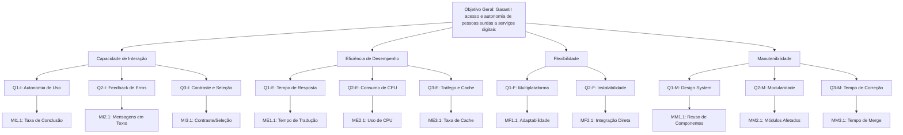

# Gráficos e Representações Visuais (GQM)

Esta seção apresenta a estrutura visual da árvore **Goal-Question-Metric** (GQM) [FanJiang and Wu 2009] e o modelo de consolidação dos resultados de qualidade para a extensão web do **VLibras** [ISO and IEC 2005].

---

## 1. Árvore Hierárquica GQM

A estrutura a seguir ilustra a rastreabilidade completa entre o objetivo estratégico, os objetivos específicos por característica da **ISO/IEC 25010:2023** [ISO and IEC 2005], as questões de pesquisa e as métricas quantitativas associadas:



---

## 2. Consolidação de Resultados: Diagrama de Radar (Kiviat)

Para a visualização do perfil de qualidade global do software, os resultados consolidados das 4 características são plotados num **Diagrama de Radar** (escala de 1.0 a 5.0 pontos):

```
                       Capacidade de Interação
                                5.0
                                 |
                                4.0
                                 |
     Manutenibilidade ----------+---------- Eficiência de Desempenho
                                 |
                                2.0
                                 |
                                1.0
                               Flexibilidade
```

### Critérios de Interpretação Visual:
* **Área de Cobertura Ampla (≥ 3.5 em todos os eixos):** Perfil equilibrado de qualidade; o software atende aos critérios de usabilidade, desempenho, portabilidade e arquitetura.
* **Vértice Recuado (< 2.5 num eixo):** Indica um gargalo específico de qualidade que exige intervenção prioritária da equipe de desenvolvimento (ex.: baixa manutenibilidade ou falhas de eficiência em redes 3G).

---

## Referências

* **FanJiang, Y.-Y. and Wu, C.-H. (2009).** *Towards a multi-agents architecture for gqm measurement system*. In 2009 Ninth International Conference on Hybrid Intelligent Systems, volume 1, pages 277-280[cite: 19].
* **Galin, D. (2018).** *Software Quality Factors (Attributes)*, pages 23–44[cite: 19].
* **ISO/IEC (2005).** *ISO/IEC 25010:2005: Systems and software engineering — Systems and software quality requirements and evaluation (SQuaRE) — System and software quality models*[cite: 19].
* **Washizaki, H. and Olszewska, J. I., editors (2024).** *Guide to the Software Engineering Body of Knowledge (SWEBOK Guide)*, Version 4.0. IEEE Computer Society, Piscataway, New Jersey[cite: 19].
## Histórico de Versões

| Versão | Data | Descrição da alteração | Autor(a) | Revisor(a) |
| ------ | ---- | ---------------------- | -------- | ---------- |
| 0.1 | 23/10/2026 | Adicionado o gráfico GQM | Mariana Pereira |
