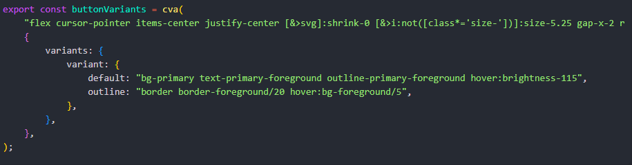
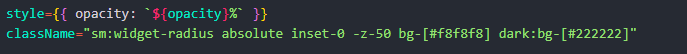
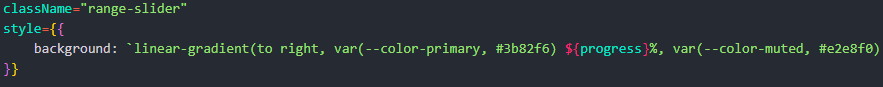

# MM1.1: Taxa de Reuso de Componentes do Design System

Esta página apresenta o resultado da métrica **MM1.1**, definida na [Fase 2](../fase-2/metricas.md#mm11-taxa-de-reuso-de-componentes-do-design-system) e executada conforme o [método de avaliação](../fase-3/metodo-de-avaliacao.md#mm11-taxa-de-reuso-de-componentes-do-design-system). A análise verifica a adoção do Design System local nos componentes visuais do widget do VLibras.

## Identificação da medição

| Item | Descrição |
| ---- | --------- |
| **Métrica** | MM1.1 — Taxa de Reuso de Componentes do Design System |
| **Característica** | Manutenibilidade |
| **Questão relacionada** | Q1-M — Reuso do Design System |
| **Data da análise** | 15/11/2026 |
| **Escopo inspecionado** | `src/widget/components/`, `src/widget/screens/`, `src/widget/dialogs/` e `src/widget/providers/toaster/` |
| **Fonte dos dados** | Análise estática do código-fonte; [inventário dos componentes](./dados-brutos/MM1.1/inventario-componentes.md) |

## Método e critério de classificação

Foram inventariados os componentes que renderizam interface nos diretórios do escopo. Testes, hooks, stores, tipos, providers sem UI própria e utilitários sem renderização foram excluídos. Cada componente foi classificado conforme o uso de primitives locais em `src/widget/components/ui/` ou de classes e tokens compartilhados do tema.

“Reutiliza” não significa que o componente não tenha HTML, layout ou estilos próprios: estilos inline dinâmicos e composições customizadas podem coexistir com primitives e tokens do sistema. “Não reutiliza” indica que o aspecto visual principal depende de valores ou estilos avulsos sem aderência suficiente aos tokens compartilhados. A classificação considera o Design System local e não afirma que cada componente use diretamente DaisyUI.

A fórmula definida para a métrica é:

`MM1.1 = (componentes que reutilizam o Design System / total de componentes de UI mapeados) × 100`

## Resultado

**Tabela 1.** Resultado da métrica MM1.1.

| Componentes que reutilizam | Componentes mapeados | Componentes que não reutilizam | Resultado |
| -------------------------: | -------------------: | -----------------------------: | -------: |
| 79 | 81 | 2 | **97,53%** |

Cálculo: `(79 / 81) × 100 = 97,53%`.

### Interpretação

O resultado supera o limite de **70%** definido para a faixa satisfatória/ideal na [matriz de critérios](../fase-2/pontuacao-e-criterios.md). Portanto, a métrica fica na faixa de pontuação **4 a 5 (satisfatório/ideal)**. Os critérios publicados não especificam qual dos dois valores atribuir dentro dessa faixa; por isso, esta página não escolhe uma nota individual.

Foram identificados dois componentes fora do padrão: `AppBackground`, que usa cores fixas, e `SettingsOpacityField`, cujo slider tem estilos próprios. Os demais 79 componentes reutilizam primitives, classes ou tokens compartilhados, embora alguns também contenham complementos visuais próprios.

### Limitações e observações

- O protocolo da Fase 3 prevê classificação independente por dois avaliadores e resolução conjunta de divergências. O registro da medição não identifica avaliadores nem documenta uma segunda classificação; assim, não é possível confirmar que essa etapa de validação foi realizada.
- O inventário inclui componentes em telas, diálogos e no provider de notificações, além de `src/widget/components/`. Esse escopo ampliado está refletido no denominador de 81 componentes.
- O resultado mede adoção do Design System conforme o critério operacional acima; não mede diretamente consistência visual percebida, acessibilidade ou custo de manutenção.

## Participação na medição

| Integrante | Contribuição |
| ---------- | ------------ |
| Rafael W. Schadt | Responsável indicado no protocolo da Fase 3 para MM1.1; análise estática e classificação do reuso do Design System. |

O esforço em horas e a participação percentual por integrante não foram registrados para esta medição e, portanto, não são estimados aqui. A [tabela geral de contribuição](../sobre/tabela-de-contribuicao.md) consolida os percentuais de esforço das entregas.

## Evidências

As capturas de tela abaixo ilustram um caso de reuso e os dois casos classificados como não conformes. O inventário completo e as evidências originais estão em [Dados brutos da MM1.1](./dados-brutos/MM1.1/README.md).

**Figura 1.** Exemplo de reuso: o `Button` define variantes com tokens compartilhados, como `bg-primary`.

**Figura 2.** `AppBackground`: cores fixas no fundo do widget.

**Figura 3.** `SettingsOpacityField`: slider com gradiente e cores definidos em estilo inline.

## Inventário dos componentes

A tabela completa com os 81 componentes classificados foi separada em [Inventário da MM1.1](./dados-brutos/MM1.1/inventario-componentes.md).

## Histórico de Versões

| Versão | Data       | Descrição da alteração                                      | Autor(a)         | Revisor(a) |
| ------ | ---------- | ----------------------------------------------------------- | ---------------- | ---------- |
| 1.0    | 15/11/2026 | Registro do método, resultado e inventário da métrica MM1.1 | Rafael W. Schadt |            |
| 1.1    | 15/11/2026 | Organização dos dados brutos e inclusão das evidências visuais | Rafael W. Schadt |            |
| 1.2    | 15/11/2026 | Separação da tabela de inventário em arquivo próprio | Rafael W. Schadt |            |
