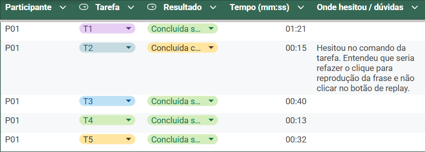

# MI1.1: Taxa de conclusão de tarefas sem assistência

Esta página registra a execução da métrica MI1.1, definida em [Métricas](../../fase-2/metricas.md), seguindo o protocolo de [Método de avaliação](../../fase-3/metodo-de-avaliacao.md) e os cenários de [Massa de dados](../../fase-3/massa-de-dados.md). Ela segue as três atividades da Fase 4: obter a medida, comparar com o critério e julgar o resultado (Aula A07, slide 20).

> Resultado: **80%** das tarefas concluídas sem assistência (4 de 5), com **1 participante**, ouvinte e com formação em Letras Libras. Não houve participantes surdos. Nível **Satisfatório/Ideal, no limite da faixa**. A hipótese H1-I **não pôde ser avaliada**, porque o perfil da participante não permite testar a dependência de leitura em português.

**Tabela 1.** Identificação da métrica.

| Item           | Registro                                                                             |
| -------------- | ------------------------------------------------------------------------------------ |
| Característica | Capacidade de Interação                                                              |
| Questão | Q1-I: Qual é o grau de autonomia de usuários surdos não alfabetizados em português para utilizar as funcionalidades de vídeo (velocidade, repetição, escolha de regionalismo) e o dicionário guiando-se apenas pela interface visual? |
| Hipótese | H1-I: Pelo menos 80% dos usuários conseguem operar os controles básicos de vídeo (repetir e mudar velocidade) guiando-se exclusivamente pelos ícones visuais, mas menos de 50% conseguem localizar e filtrar sinais no dicionário ou alterar o regionalismo sem depender da leitura de textos em português ([Hipóteses](../../fase-2/hipoteses.md)) |
| Cálculo        | X = (A / B) × 100, com A = tarefas concluídas sem assistência e B = tarefas tentadas |
| Data da coleta | 18/11/2026, às 15:24                                                                 |
| Responsáveis   | Amanda C. Lima e Ludmila O. Nunes                                                    |

## 1. Obter a medida

### Recrutamento e perfil da amostra

O protocolo previa no mínimo 8 pessoas usuárias de Libras, priorizando pessoas surdas. A equipe tentou contato com pessoas surdas usuárias de Libras por meio de convite a institutos e associações de Libras no Instagram, contatos pessoais e comunidade da UnB entre 15 e 18 de novembro. Dos 8 contatos feitos, 1 respondeu, e nenhuma pessoa surda conseguiu participar dentro do prazo de coleta.

Participou apenas **uma pessoa (P01)**, ouvinte e formada em Letras Libras. Isso aciona o plano B da [Massa de dados](../../fase-3/massa-de-dados.md), que aceita ouvintes fluentes em Libras e exige reportar os resultados por perfil. A consequência é central para a leitura desta página: P01 tem português como língua nativa e conhece Libras profissionalmente. Ela não representa o usuário surdo com pouca leitura em português, que é o foco da Q1-I e da H1-I. Os dados mostram, portanto, se as tarefas e a interface funcionam para uma pessoa experiente, e não a autonomia do público-alvo.

**Tabela 2.** Perfil da participante (anônimo).

| Código | Condição auditiva | Relação com a Libras                     | Fluência em português | Experiência com o VLibras | Dificuldade visual |
| ------ | ----------------- | ---------------------------------------- | --------------------- | ------------------------- | ------------------ |
| P01    | Ouvinte           | Ouvinte, com formação superior em Libras | Alta (nativa)         | Já usou poucas vezes      | Não                |

### Execução

A sessão foi presencial, em 18/11/2026, e seguiu o protocolo: consentimento, perfil, aquecimento de 2 minutos, cenários T1 a T5 apresentados oralmente, gravação de tela autorizada e limite de 2 minutos por cenário. A equipe não respondeu dúvidas durante as tarefas. A sessão usou o widget publicado, versão 7.12.2, no navegador Opera GX Stable 139.0.6053.63 (64 bits), no dispositivo DI6, com rede Wi-Fi.

**Tabela 3.** Resultado por cenário (P01).

| Cenário   | Função avaliada                                       | Resultado           | Tempo (mm:ss) |    Taxa |
| --------- | ----------------------------------------------------- | ------------------- | ------------: | ------: |
| T1        | Abrir o widget, selecionar texto e iniciar a tradução | Sem assistência     |         01:21 |    100% |
| T2        | Repetição e velocidade                                | **Com assistência** |         00:15 |      0% |
| T3        | Dicionário                                            | Sem assistência     |         00:40 |    100% |
| T4        | Regionalismo                                          | Sem assistência     |         00:13 |    100% |
| T5        | Seleção parcial de texto                              | Sem assistência     |         00:32 |    100% |
| **Total** |                                                       | **4 de 5**          | mediana 00:32 | **80%** |

Fonte: elaborado pelos autores, a partir da planilha de observação.

**Tabela 4.** Resultado por perfil.

| Grupo                          | Participantes | Tentativas | Sem assistência | Taxa |
| ------------------------------ | ------------: | ---------: | --------------: | ---: |
| Surdos / deficientes auditivos |             0 |          0 |               0 |  n/a |
| Ouvintes fluentes em Libras    |             1 |          5 |               4 |  80% |

Fonte: elaborado pelos autores.

**Tabela 5.** Estatísticas de tempo.

| Indicador                       |      Valor |
| ------------------------------- | ---------: |
| Tempo total das 5 tarefas       |      03:01 |
| Média por tarefa                |      00:36 |
| Mediana                         |      00:32 |
| Maior tempo                     | 01:21 (T1) |
| Tarefas que estouraram os 2 min |          0 |

Fonte: elaborado pelos autores.

**Medida obtida:** X = A / B × 100 = 4 / 5 × 100 = **80%**.

## 2. Comparar com o critério

**Tabela 6.** Comparação com os níveis de pontuação da MI1.1.

| Nível              | Faixa ([Pontuação e critérios](../../fase-2/pontuacao-e-criterios.md)) | Resultado |
| ------------------ | ------------------------------------------------------------------- | --------- |
| Ruim               | < 50%                                                               |           |
| Aceitável/Regular  | 50% a 79%                                                           |           |
| Satisfatório/Ideal | ≥ 80%                                                               | **80%**   |

Fonte: elaborado pelos autores.

O resultado está exatamente no limite da faixa. Com B = 5, cada tarefa vale 20 pontos percentuais, então uma única tarefa diferente muda o nível.

**Tabela 7.** Sensibilidade do resultado.

| Cenário                         | A / B |    X | Nível              |
| ------------------------------- | ----- | ---: | ------------------ |
| Resultado oficial               | 4 / 5 |  80% | Satisfatório/Ideal |
| T2 contada como sem assistência | 5 / 5 | 100% | Satisfatório/Ideal |

Fonte: elaborado pelos autores.

## 3. Julgar o resultado

1. **Quase todas as tarefas foram simples para P01.** Quatro das cinco foram concluídas sem ajuda, todas dentro do limite de 2 minutos. Dicionário (T3, 40 s), regionalismo (T4, 13 s) e seleção parcial (T5, 32 s) foram encontrados e executados sem hesitação registrada.
2. **A T1 foi a mais demorada (01:21).** É a porta de entrada: abrir o widget, selecionar um parágrafo longo (F9) e iniciar a tradução, sem instrução. Foi também a que mais se aproximou do limite de 2 minutos. O tempo incluiu a sinalização completa do avatar.
3. **A T2 teve assistência por dúvida sobre o comando.** P01 hesitou no comando da tarefa e entendeu que deveria refazer o clique para reproduzir a frase de novo, em vez de usar o botão de repetição. A dúvida pode vir de duas causas: a forma como o cenário foi apresentado oralmente ser ambígua, ou o ícone de repetição não ser reconhecível como tal. A equipe precisou dizer que algum botão de repetição deveria ser utilizado. Como foi a única participante, não dá para separar as duas causas, e isso merece ser testado com mais pessoas, de preferência surdas.
4. **O perfil da amostra impede conclusões sobre o público-alvo.** P01 lê português com fluência nativa e pode ter se apoiado no texto da interface para decidir, então não é possível afirmar se os ícones foram suficientes.
5. **Hipótese H1-I: não avaliável.** Neste caso isolado, o controle de vídeo da T2 exigiu ajuda e o dicionário e o regionalismo (T3 e T4) não, o oposto do previsto, mas o perfil de P01 não permite concluir nada sobre quem depende de ícones.

**Julgamento:** pela fórmula definida na Fase 2, a MI1.1 fica em **80%**, no limite do nível **Satisfatório/Ideal**, mas o resultado vale apenas para uma pessoa ouvinte, fluente em Libras e em português. O achado mais útil é a dúvida da T2: o botão de repetição e o texto do cenário podem não ser claros, e a verificação com pessoas surdas continua pendente. Recomenda-se repetir a coleta com participantes surdos.

## Evidências

**Figura 1.** Planilha de observação da sessão com P01 (resultado, tempo e observações por cenário). Fonte: elaborado pelos autores.

Os dados completos estão em [Dados brutos da MI1.1](./../dados-brutos/MI1.1/README.md):

- `tabela/coleta.md`: identificação da sessão, perfil, observação por cenário, cálculo e desvios;
- `prints/`: capturas das telas da sessão;

### Gravação da sessão

<iframe width="560" height="315" src="https://www.youtube.com/embed/-D0_mR5q2Is?si=KwnDSXIGLvtdpvBR" title="YouTube video player" frameborder="0" allow="accelerometer; autoplay; clipboard-write; encrypted-media; gyroscope; picture-in-picture; web-share" referrerpolicy="strict-origin-when-cross-origin" allowfullscreen></iframe>

## Limitações

- **Amostra mínima.** 1 participante e 5 tentativas, em vez de 8 e 40. O resultado é um estudo de caso e não permite generalizar.
- **Sem participantes surdos.** Não foi possível recrutar pessoas surdas usuárias de Libras no prazo. Nenhuma conclusão sobre a H1-I é sustentada.
- **Participante ouvinte e fluente em português.** O resultado não mede dependência de leitura de texto.
- **Apresentação oral dos cenários.** Os cenários foram falados, e não apresentados por cartão e vídeo em Libras como previsto.
- **Taxa em saltos de 20 pontos.** Com 5 tarefas, qualquer mudança em uma tarefa altera o nível.
- **Navegador.** A sessão usou o Opera GX, que tem bloqueadores e limitadores de recursos próprios.

## Participação na coleta

| Integrante       | Contribuição                                                       |
| ---------------- | ------------------------------------------------------------------ |
| Ludmila O. Nunes | Recrutamento, condução e observação da sessão e registro da MI1.1. |
| Amanda C. Lima   | Condução e observação da sessão.                                   |

## Referências

> RAMOS, Cristiane Soares. **Aula A07: Processo de Avaliação de Produto**. Slides da disciplina Qualidade de Software 1. Brasília: Universidade de Brasília, 2026.

> ISO/IEC. **ISO/IEC 25010:2023**: systems and software engineering: systems and software quality requirements and evaluation (SQuaRE): product quality model. 2. ed. Geneva: ISO/IEC, 2023.

## Histórico de Versões

| Versão | Data       | Descrição da alteração                        | Autor(a)         | Revisor(a) |
| ------ | ---------- | --------------------------------------------- | ---------------- | ---------- |
| 0.1    | 22/11/2026 | Registro da execução e do julgamento da MI1.1 | Ludmila O. Nunes |            |