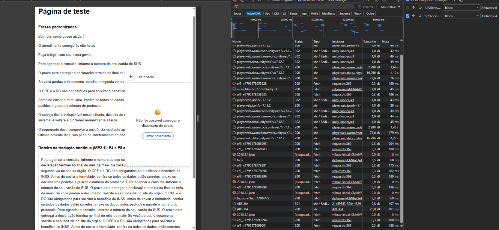
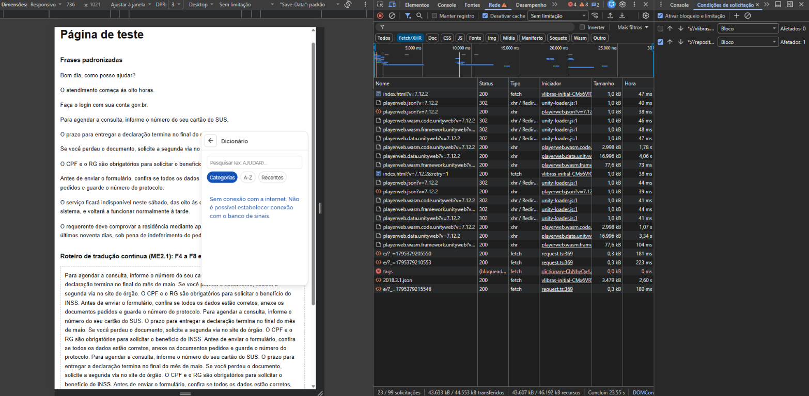
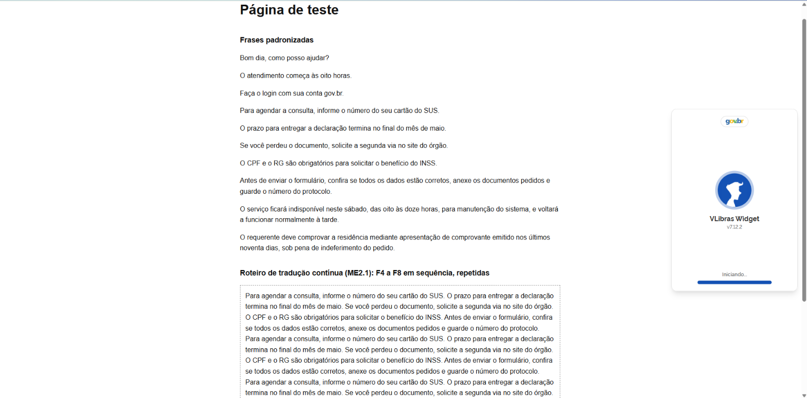

# MI2.1: Proporção de mensagens apenas em texto

Esta página apresenta o resultado da MI2.1, definida em [Métricas](../../fase-2/metricas.md#mi21-proporcao-de-mensagens-apenas-em-texto), relacionada à questão Q2-I e executada conforme o [Método de avaliação](../../fase-3/metodo-de-avaliacao.md#mi21-proporcao-de-mensagens-apenas-em-texto). A métrica verifica a proporção de mensagens visíveis de erro e status que são apresentadas somente em texto, sem ícone explicativo ou sinalização do avatar.

> **Resultado provisório:** 6 de 10 apresentações observadas foram classificadas como somente texto (**60%**). Pelos critérios da Fase 2, o resultado está na faixa **Aceitável/Regular**. A hipótese H2-I, que previa resultado acima de 70%, não foi confirmada nesta coleta exploratória.

**Tabela 1.** Identificação da medição.

| Item | Registro |
| ---- | -------- |
| Métrica | MI2.1 — Proporção de mensagens apenas em texto |
| Característica | Capacidade de Interação |
| Questão relacionada | Q2-I — Feedback Visual e Proteção contra Erros |
| Hipótese | H2-I — Mais de 70% das mensagens de erro ou status são exibidas apenas em texto em português ([Hipóteses](../../fase-2/hipoteses.md)). |
| Data dos testes | 22/11/2026 |
| Revisão do código inspecionado | `d79ca86` |
| Execução | Testes manuais relatados pelo avaliador; capturas de tela e DevTools fornecidos. |
| Resultado | Provisório; ambientes e versões diferem entre parte dos casos. |

## 1. Obter a medida

O registro inventariou 15 apresentações candidatas: sete mensagens de erro ou ausência de resultado (E1–E7) e oito mensagens de status (S1–S8). A classificação considera cada apresentação como unidade, inclusive textos iguais em componentes diferentes.

Há evidências das tentativas para as 15 apresentações. Em dez delas, a captura mostra a mensagem candidata e permite classificá-la: seis somente em texto e quatro com recurso visual. Nas outras cinco (E1, S4, S5, S6 e S7), a imagem registra a tentativa ou um estado diferente/posterior, mas não mostra o texto/status candidato. Por isso, esses cinco candidatos ficam fora do cálculo, conforme o protocolo. A ausência da mensagem específica na captura não significa que a tentativa não tenha ocorrido nem que a mensagem seja impossível de reproduzir.

**Tabela 2.** Contagem das mensagens observadas.

| Classificação | Quantidade | IDs |
| ------------- | ---------: | --- |
| Somente texto (A) | 6 | E4, E5, E6, E7, S1 e S8 |
| Com recurso visual | 4 | E2, E3, S2 e S3 |
| Tentativa registrada, mas texto candidato não capturado; fora do cálculo | 5 | E1, S4, S5, S6 e S7 |
| **Total de apresentações candidatas** | **15** | **E1–E7 e S1–S8** |
| **Mensagens capturadas e incluídas no denominador (B)** | **10** | |

O cálculo é `X = (A / B) × 100`, em que A é o número de mensagens observadas somente em texto e B é o total de mensagens observadas e classificadas:

**MI2.1 = (6 / 10) × 100 = 60%.**

A tabela completa, com textos, gatilhos, classificação, origem registrada e evidências, está em [Tabela de coleta da MI2.1](../dados-brutos/MI2.1/tabela/coleta.md).

### Critério adotado

- **Somente texto:** não foi observado ícone explicativo nem sinalização do avatar associada à mensagem. Cor e barra de progresso, por si sós, não contam como esses recursos.
- **Com recurso visual:** foi observado ícone, indicador visual de carregamento ou sinalização do avatar associado à mensagem.
- Falhas sem uma mensagem visível foram registradas como achados qualitativos separados; não entram no numerador ou denominador.

E5 (“Nenhuma categoria encontrada”) e E6 (“Sem resultados para...”) são estados vazios, não erros técnicos. Foram mantidos por serem mensagens de status visíveis; seu tratamento afeta o escopo da métrica e é discutido na sensibilidade.

## 2. Comparar com o critério

**Tabela 3.** Comparação com os níveis de pontuação da MI2.1.

| Nível | Faixa ([Pontuação e critérios](../../fase-2/pontuacao-e-criterios.md)) | Resultado |
| ----- | ------------------------------------------------------------------- | --------- |
| Ruim (1 a 2) | > 70% | |
| Aceitável/Regular (3) | 31% a 70% | **60%** |
| Satisfatório/Ideal (4 a 5) | ≤ 30% | |

O resultado observado fica na faixa **Aceitável/Regular**, correspondente ao grupo de pontuação 3. A MI2.1 mede a proporção de mensagens somente em texto; portanto, uma proporção menor representa maior uso de recursos visuais segundo a definição operacional.

### Sensibilidade às decisões de contagem

**Tabela 4.** Cenários alternativos para as fronteiras da contagem.

| Cenário | A / B | Resultado | Faixa |
| ------- | ----- | --------: | ----- |
| Critério primário: E2 e E3 separados; E5 e E6 incluídos | 6 / 10 | 60% | Aceitável/Regular |
| E3 tratado como parte da apresentação E2 | 6 / 9 | 66,7% | Aceitável/Regular |
| E5 e E6 excluídos como estados vazios | 4 / 8 | 50% | Aceitável/Regular |

Os cenários alternativos permanecem na mesma faixa de pontuação, mas a regra de unidade e o tratamento de estados vazios devem ser mantidos explícitos para permitir comparação consistente em novas coletas.

## 3. Julgar o resultado

1. **Há mensagens de erro do dicionário somente em texto.** E4, E5, E6 e E7 não apresentaram ícone explicativo nas capturas; E5 e E6, porém, são estados vazios, e não falhas técnicas.
2. **Mensagens de carregamento variam.** S1 foi classificada como somente texto porque a barra de progresso, pelo critério adotado, não é um ícone explicativo nem sinalização do avatar. S2 e S3 exibiram indicadores de carregamento associados.
3. **E2 e E3 foram consideradas apresentações distintas.** E3 aparece após repetidas tentativas e compartilha o emoji triste da tela E2. Se ambas forem tratadas como uma única apresentação, a taxa passa a 66,7%, sem mudar de faixa.
4. **S8 requer cautela.** O toast observado não tinha ícone e foi classificado como somente texto. O código registrado também chama `playStatic("OBRIGADO")`; a captura do avatar é estática e não basta, isoladamente, para determinar toda a sinalização durante a animação.
5. **H2-I não se confirmou entre as mensagens capturadas.** A hipótese previa mais de 70% de mensagens somente em texto, enquanto a contagem primária encontrou 60%. Como cinco textos candidatos não aparecem nas capturas e os ambientes/versões variaram, isso não é uma conclusão definitiva sobre todo o produto.
6. **Foram registradas falhas sem aviso.** Bloqueios de tradução, feedback, carregamento de sinais de categoria e arquivo de sinal tiveram comportamento observado sem uma mensagem clara de falha. Esses casos são achados qualitativos distintos e não foram somados à taxa da MI2.1.

**Julgamento:** a MI2.1 fica provisoriamente em **60%**, na faixa **Aceitável/Regular**. O resultado sugere oportunidades para associar feedback visual às mensagens de erro/status; uma nova execução deve tentar reproduzir os cinco estados não observados e confirmar o comportamento nas mesmas versões do widget e do código analisado.

## Evidências

As capturas originais estão em [Dados brutos da MI2.1](../dados-brutos/MI2.1/README.md). Abaixo estão exemplos representativos:

**Figura 1.** E2: a mensagem de erro do dicionário aparece junto a um emoji.

**Figura 2.** E4: mensagem de conexão sem ícone explicativo observado.

**Figura 3.** S1: mensagem de status acompanhada de barra de progresso.

**Figura 4.** S8: toast de agradecimento; a captura não registra por si só toda a animação do avatar.

## Falhas observadas sem mensagem

| Caso | Registro |
| ---- | -------- |
| Tradução | Bloqueio de `/translate`; foi observada soletração, sem aviso de falha. |
| Envio de feedback | Bloqueio de `/review`; a interface prosseguiu sem aviso. O registro recomenda confirmar esse comportamento em nova execução. |
| Sinais de categoria | Bloqueio de `/tagsigns`; a categoria abriu com lista vazia e sem aviso. |
| Arquivo de sinal | Solicitação bloqueada; foi observada soletração sem aviso de falha. |

As capturas correspondentes estão listadas na [tabela de coleta](../dados-brutos/MI2.1/tabela/coleta.md#falhas-observadas-sem-mensagem).

## Limitações

- Os testes e capturas foram fornecidos pelo avaliador; não houve execução independente.
- Alguns estados são transitórios. A ausência na captura não comprova ausência em todas as execuções.
- E1 foi testado no gov.br e os demais casos em página HTML de teste. Os prints mostram o player `v7.12.2`; o registro identifica um módulo servido pelo pacote `v7.12.3` na página de teste. Não se presume que todos os recursos executados correspondam exatamente à revisão inspecionada `d79ca86`.
- As tentativas das 15 candidatas têm evidências; cinco capturas não mostram o texto/status candidato. O cálculo considera as dez mensagens que puderam ser classificadas visualmente, não os 15 candidatos.
- O critério considera cada apresentação separadamente e mantém estados vazios E5 e E6 no escopo. A análise de sensibilidade mostra o efeito de decisões alternativas.
- A sinalização associada a S8 não pode ser concluída apenas com uma captura estática do avatar.

## Participação na coleta

O registro fornecido não identifica nominalmente o responsável pela execução. A coleta e as capturas são atribuídas ao “avaliador” no material de origem.

## Histórico de Versões

| Versão | Data | Descrição da alteração | Autor(a) | Revisor(a) |
| ------ | ---- | ---------------------- | -------- | ---------- |
| 0.1 | 22/11/2026 | Organização dos dados fornecidos, cálculo provisório e julgamento da MI2.1 | Rafael W. Schadt | |
