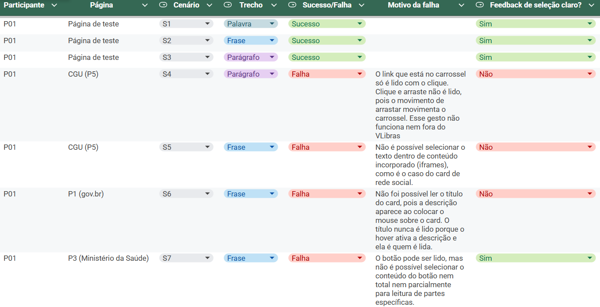

# MI3.2: Taxa de eficácia na seleção de texto

Esta página registra a execução da métrica MI3.2, definida em [Métricas](../../fase-2/metricas.md), seguindo o protocolo de [Método de avaliação](../../fase-3/metodo-de-avaliacao.md) e as tarefas de [Massa de dados](../../fase-3/massa-de-dados.md). Ela segue as três atividades da Fase 4: obter a medida, comparar com o critério e julgar o resultado (Aula A07, slide 20).

> Resultado: **42,9%** das tentativas de seleção de texto com sucesso (3 de 7), com **1 participante**, ouvinte e com formação superior em Libras. Nível **Ruim**. Na página de teste, as 3 tarefas tiveram sucesso. Nas 4 tarefas em portais, nenhuma teve. A hipótese H4-I foi **confirmada em parte**: a falta de feedback visual apareceu em 3 de 7 tentativas (42,9%), acima dos 30% previstos, mas parte das falhas veio de limites técnicos do widget em carrosséis, *iframes*, cards e botões.

**Tabela 1.** Identificação da métrica.

| Item           | Registro                                                                                                           |
| -------------- | ------------------------------------------------------------------------------------------------------------------ |
| Característica | Capacidade de Interação                                                                                            |
| Questão | Q3-I: Qual é a eficácia da seleção de textos e a conformidade de contraste visual dos elementos do widget quando sobrepostos aos diferentes layouts das páginas do Governo Federal? Esta métrica responde à parte da seleção de textos. O contraste é tratado na MI3.1. |
| Hipótese | H4-I: Em cerca de 30% das tentativas de uso, o usuário comete erros ao selecionar blocos de texto na página web, devido à ausência de feedback visual claro do modo de seleção ([Hipóteses](../../fase-2/hipoteses.md)) |
| Cálculo        | X = (A / B) × 100, com A = seleções de texto efetuadas com sucesso e B = total de tentativas de seleção executadas |
| Data da coleta | 18/11/2026 15:35                                                                                                   |
| Responsáveis   | Amanda C. Lima e Ludmila O. Nunes                                                                                  |

## 1. Obter a medida

### Participante e execução

A MI3.2 foi coletada na mesma sessão da [MI1.1](./mi1-1-conclusao-tarefas-sem-assistencia.md), com a mesma participante: **P01**, ouvinte e com formação superior em Libras. Não houve participantes surdos, e o perfil e o recrutamento estão descritos na página da MI1.1. A sessão foi presencial, com o widget publicado, versão 7.12.2, no navegador Opera GX Stable 139.0.6053.63 (64 bits), no dispositivo DI6, com rede Wi-Fi e gravação de tela autorizada.

P01 cumpriu as 7 tarefas (S1 a S7), em ordem fixa, uma tentativa por tarefa, com limite de 2 minutos. As tarefas foram apresentadas oralmente, e a equipe não ajudou durante a execução. Nas tarefas da página de teste (S1 a S3), o widget usado foi o publicado, versão 7.12.2, injetado pelo código padrão de instalação. Nas tarefas dos portais (S4 a S7, em CGU, gov.br e Ministério da Saúde), foi usado o widget já instalado por cada portal, cuja versão também é a 7.12.2.

**Tabela 2.** Resultado por tarefa (P01).

| Tarefa    | Página                   | Elemento                       | Trecho          | Resultado  | Feedback de seleção claro? |
| --------- | ------------------------ | ------------------------------ | --------------- | ---------- | -------------------------- |
| S1        | Página de teste          | Texto comum                    | Palavra         | Sucesso    | Sim                        |
| S2        | Página de teste          | Texto comum                    | Frase           | Sucesso    | Sim                        |
| S3        | Página de teste          | Texto comum                    | Parágrafo       | Sucesso    | Sim                        |
| S4        | CGU (P5)                 | Carrossel de destaques         | Trecho do slide | **Falha**  | **Não**                    |
| S5        | CGU (P5)                 | Card de rede social (*iframe*) | Frase           | **Falha**  | **Não**                    |
| S6        | P1 (gov.br)              | Card de categorias             | Título do card  | **Falha**  | **Não**                    |
| S7        | P3 (Ministério da Saúde) | Botão                          | Texto do botão  | **Falha**  | Sim                        |
| **Total** |                          |                                |                 | **3 de 7** | Ausente em 3 de 7          |

Fonte: elaborado pelos autores, a partir da planilha de observação.

**Tabela 3.** Motivo de cada falha.

| Tarefa | Motivo registrado                                                                                        | Tipo (classificação dos autores)                                             |
| ------ | -------------------------------------------------------------------------------------------------------- | ---------------------------------------------------------------------------- |
| S4 | O link do carrossel só é lido com o clique. Clicar e arrastar não funciona, porque o arrasto move o carrossel. Esse gesto não funciona nem fora do VLibras | Conflito com o componente da página (limitação técnica) e falta de *feedback* |
| S5     | Não é possível selecionar o texto dentro de conteúdo incorporado (*iframes*), como o card de rede social | Limitação técnica e falta de *feedback*                                      |
| S6     | O título do card não foi lido, porque a descrição aparece ao passar o mouse e é ela que o widget lê      | Conflito com o comportamento do card (limitação técnica) e falta de feedback |
| S7     | O botão pode ser lido, mas não é possível selecionar o conteúdo dele, total ou parcialmente              | Limitação técnica                                                            |

Fonte: elaborado pelos autores, a partir da planilha de observação. A coluna "Tipo" foi preenchida na análise, e não durante a sessão.

**Tabela 4.** Resultado por tipo de página e de elemento.

| Grupo                                  | Tentativas | Sucessos |      Taxa |
| -------------------------------------- | ---------: | -------: | --------: |
| Página de teste (texto comum: S1 a S3) |          3 |        3 |      100% |
| Portais (S4 a S7)                      |          4 |        0 |        0% |
| Carrossel (S4)                         |          1 |        0 |        0% |
| Conteúdo incorporado (S5)              |          1 |        0 |        0% |
| Card (S6)                              |          1 |        0 |        0% |
| Botão (S7)                             |          1 |        0 |        0% |
| **Total**                              |      **7** |    **3** | **42,9%** |

Fonte: elaborado pelos autores.

**Medida obtida:** X = A / B × 100 = 3 / 7 × 100 = **42,9%**.

## 2. Comparar com o critério

**Tabela 5.** Comparação com os níveis de pontuação da MI3.2.

| Nível                      | Faixa ([Pontuação e critérios](../../fase-2/pontuacao-e-criterios.md)) | Resultado |
| -------------------------- | ---------------------------------------------------------------------- | --------- |
| Ruim (1 a 2)               | < 70%                                                                  | **42,9%** |
| Aceitável/Regular (3)      | 70% a 89%                                                              |           |
| Satisfatório/Ideal (4 a 5) | ≥ 90%                                                                  |           |

Fonte: elaborado pelos autores.

**Tabela 6.** Sensibilidade do resultado.

| Cenário                                               | A / B |     X | Nível             |
| ----------------------------------------------------- | ----- | ----: | ----------------- |
| Resultado oficial                                     | 3 / 7 | 42,9% | Ruim              |
| S7 contada como sucesso (o botão foi lido por clique) | 4 / 7 | 57,1% | Ruim              |
| S4 e S7 contadas como sucesso (texto lido por clique) | 5 / 7 | 71,4% | Aceitável/Regular |

Fonte: elaborado pelos autores.

O protocolo exige que a tradução parta de uma **seleção** de texto. Os dois últimos cenários contam como sucesso as tarefas em que o texto foi lido por clique, o que muda o nível, mas não é o critério definido. No segundo, a S4 também ignora a falta de feedback claro registrada na tarefa. Por isso, o resultado oficial é o primeiro.

## 3. Julgar o resultado

1. **Texto comum funciona.** Na página de teste, palavra, frase e parágrafo foram selecionados e traduzidos, todos com feedback visual claro.
2. **Nos portais, nenhuma tarefa teve sucesso.** As 4 falhas ocorreram em elementos que não são parágrafos comuns: carrossel, conteúdo incorporado, card e botão.
3. **O gesto de selecionar conflita com o componente.** No carrossel (S4), arrastar para selecionar move os slides, e a P01 observou que isso também ocorre sem o VLibras. A leitura só funcionou por clique. No card (S6), passar o mouse abre a descrição, e o widget lê a descrição em vez do título.
4. **Conteúdo incorporado não é alcançado (S5).** O texto dentro de *iframe* não pôde ser selecionado. O mesmo comportamento está relatado na *issue* #13 do repositório (*iframes*), ainda aberta, o que sugere um limite conhecido do widget (ver [MM3.1](../manutenibilidade/mm3-1/mm3-1-tempo-medio-de-correcao-de-incompatibilidades.md)).
5. **Falta de feedback claro em 3 de 7 tentativas (42,9%).** Isso ocorreu na S4, na S5 e na S6. Só na S7 o feedback do modo de seleção estava presente, mas a seleção do texto do botão não era possível.
6. **Hipótese H4-I: confirmada em parte.** A falta de feedback visual apareceu em 42,9% das tentativas, acima dos cerca de 30% previstos. Os erros de seleção foram ainda mais frequentes (4 de 7, ou 57,1%), e uma parte tem causa técnica (carrossel, *iframe*, card e botão), e não só de feedback. Com 1 participante, não é possível generalizar.

**Julgamento:** pela fórmula definida na Fase 2, a MI3.2 fica no nível **Ruim** (X = 42,9%). O widget seleciona e traduz texto comum sem dificuldade, mas falha nos elementos dinâmicos e incorporados dos portais, e em três deles não avisa claramente a pessoa. Sugestões de melhoria: permitir a leitura de botões e cards por clique ou foco com feedback visual, tratar o conflito com carrosséis e informar quando a seleção não é possível (por exemplo, dentro de *iframes*).

## Evidências

**Figura 1.** Planilha de observação da MI3.2 (resultado, motivo da falha e feedback por tarefa). Fonte: elaborado pelos autores.

Os dados completos estão em [Dados brutos da MI3.2](./../dados-brutos/MI3.2/README.md):

- `tabela/coleta.md`: identificação da sessão, observação por tarefa, trechos usados, cálculo e desvios;
- `prints/`: planilha de observação e capturas das páginas;

### Gravação da sessão

<iframe width="560" height="315" src="https://www.youtube.com/embed/LkOqW3fCV_g?si=GFXGel1Av75RgmTC" title="YouTube video player" frameborder="0" allow="accelerometer; autoplay; clipboard-write; encrypted-media; gyroscope; picture-in-picture; web-share" referrerpolicy="strict-origin-when-cross-origin" allowfullscreen></iframe>

## Limitações

- **Amostra mínima.** 1 participante e 7 tentativas, em vez de 8 e 56. O resultado é um estudo de caso, e cada tarefa vale 14,3 pontos percentuais.
- **Sem participantes surdos.** O resultado vale para uma pessoa ouvinte. A seleção de texto não depende da leitura de português, mas a percepção do feedback visual pode variar por perfil.
- **Uma tentativa por tarefa.** As falhas não foram repetidas, e o carrossel e o card de rede social mudam com o tempo.
- **Seleção por mouse, em computador.** Não foi testada a seleção por toque no celular.
- **Dados de apoio não coletados.** Foram registrados apenas resultado, motivo da falha e feedback visual. O tempo, a verificação separada de "tradução iniciada" e "área correta", e a estratégia alternativa não foram registrados, e o tipo da falha foi classificado depois, na análise.
- **Critério de sucesso.** O protocolo exige seleção. A S4 e a S7 foram lidas por clique, e a Tabela 6 mostra o efeito de contá-las como sucesso.

## Participação na coleta

| Integrante       | Contribuição                                                       |
| ---------------- | ------------------------------------------------------------------ |
| Ludmila O. Nunes | Recrutamento, condução e observação da sessão e registro da MI3.2. |
| Amanda C. Lima   | Condução e observação da sessão.                                   |

## Referências

> RAMOS, Cristiane Soares. **Aula A07: Processo de Avaliação de Produto**. Slides da disciplina Qualidade de Software 1. Brasília: Universidade de Brasília, 2026.

> ISO/IEC. **ISO/IEC 25010:2023**: systems and software engineering: systems and software quality requirements and evaluation (SQuaRE): product quality model. 2. ed. Geneva: ISO/IEC, 2023.

## Histórico de Versões

| Versão | Data       | Descrição da alteração                        | Autor(a)         | Revisor(a) |
| ------ | ---------- | --------------------------------------------- | ---------------- | ---------- |
| 0.1    | 22/11/2026 | Registro da execução e do julgamento da MI3.2 | Ludmila O. Nunes |            |