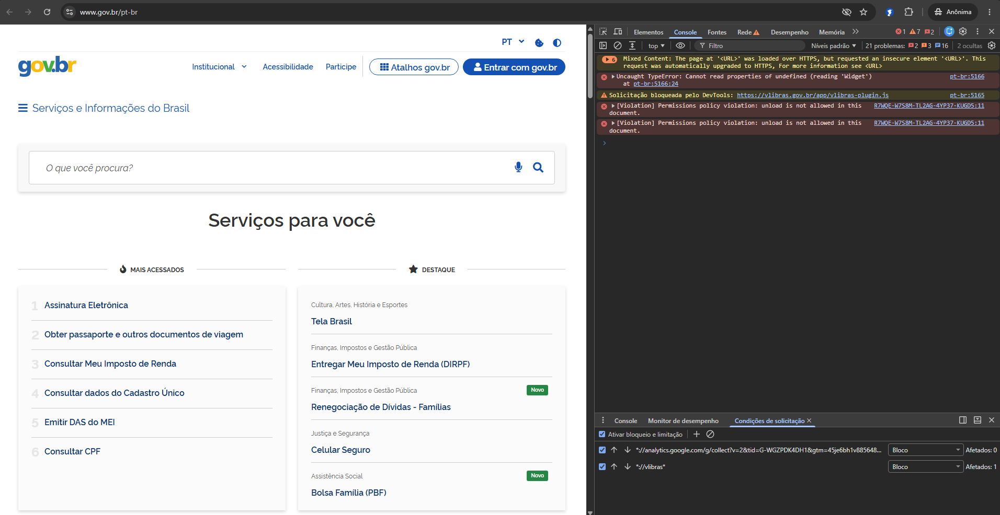
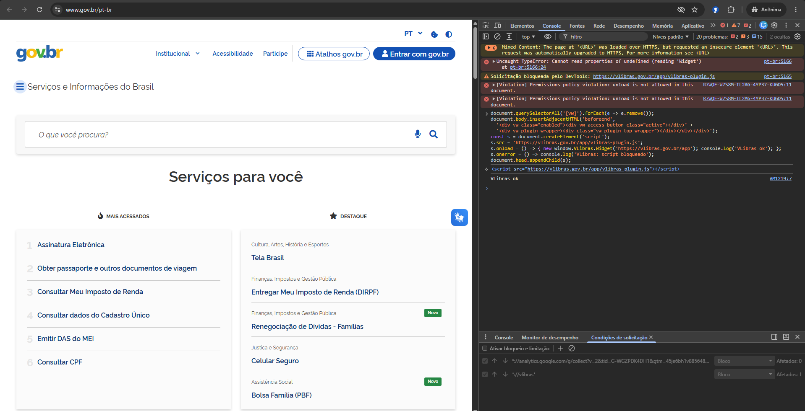
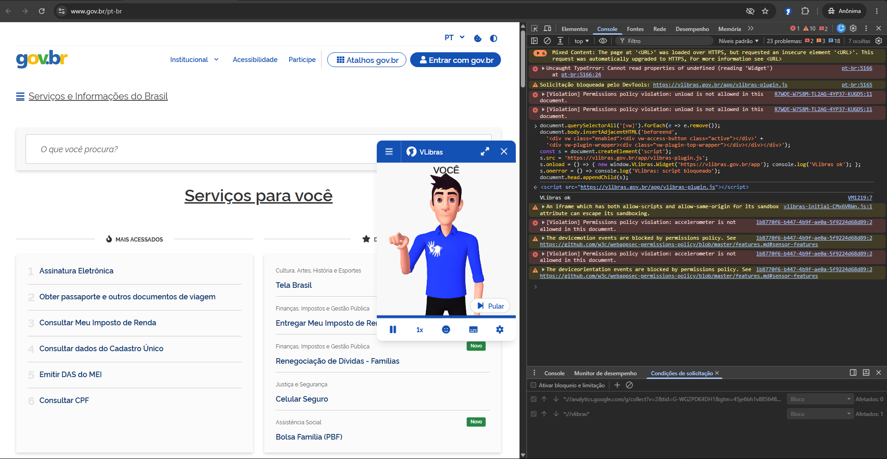

# MF2.1: Taxa de integração sem ajuste manual

Esta página registra a execução da métrica MF2.1, definida em [Métricas](../../../fase-2/metricas.md#mf21-taxa-de-integração-sem-ajuste-manual), seguindo o protocolo de [Método de avaliação](../../../fase-3/metodo-de-avaliacao.md#mf21-taxa-de-integração-sem-ajuste-manual) e os portais de [Massa de dados](../../../fase-3/massa-de-dados.md#portais-da-amostra). Ela segue as três atividades da Fase 4: obter a medida, comparar com o critério e julgar o resultado (Aula A07, slide 20).

> Resultado: o código padrão do widget funcionou sem nenhum ajuste nos **10 portais** testados, X = **100%**. Pelos critérios da Fase 2, o nível é **Ideal** (≥ 80%). A hipótese H2-F, que previa ajustes em 20% dos portais, **não foi confirmada**: nenhum portal precisou de ajuste.

**Tabela 1.** Identificação da métrica.

| Item | Registro |
| ---- | -------- |
| Métrica | MF2.1: Taxa de integração sem ajuste manual |
| Característica | Flexibilidade (ISO/IEC 25010:2023) |
| Questão | Q2-F: Qual é a frequência de problemas de integração que exigem adaptações específicas de código ou estilo ao incorporar o widget em diferentes portais web? |
| Hipótese | H2-F: Em 80% das páginas governamentais a instalação padrão funciona imediatamente, e em 20% é preciso ajuste manual por conflitos de CSS ou bloqueio de scripts ([Hipóteses](../../../fase-2/hipoteses.md)) |
| Objeto | Código padrão de instalação do widget (`vlibras.gov.br/app/vlibras-plugin.js`), injetado em cada portal |
| Amostra | 10 portais do Governo Federal (P1 a P10) |
| Cálculo | X = A / B × 100 |
| Data da coleta | 22/11/2026 |
| Responsável | Amanda C. Lima |

## 1. Obter a medida

### Ambiente

| Item | Configuração |
| ---- | ------------ |
| Dispositivo | DI1, desktop com Windows 11 ([Recursos e ambiente](../../../fase-3/recursos-e-ambiente.md)) |
| Navegador | Google Chrome (Versão 157.0.8103.80 (Versão oficial) 64 bits), em janela anônima |
| Registro | Prints de cada etapa, com o DevTools aberto ao lado da página |

### Como a medida foi obtida

Os 10 portais da amostra já tinham o VLibras instalado pelos próprios órgãos. Testar essa instalação não responderia à métrica, porque o órgão pode ter feito ajustes para o widget funcionar. Injetar o código padrão por cima também não, porque a página ficaria com duas instâncias do widget. Por isso, a instalação de cada portal foi bloqueada antes da injeção.

Em cada portal:

1. Com o DevTools aberto, ativar no painel "Condições de solicitação" o bloqueio dos padrões `*://vlibras*`, `*://vlibras.gov.br/*` e `*://*/*vlibras*` e recarregar a página. Os dois últimos padrões foram acrescentados durante o teste do Banco Central (P7), porque o primeiro não alcançava a cópia própria do portal; nos portais testados antes dele (P1 a P4), o primeiro padrão foi suficiente. O botão do VLibras não aparece, e o console registra a solicitação bloqueada.
2. Desativar o bloqueio, sem recarregar a página.
3. Colar no console o código padrão de instalação e aguardar a mensagem `VLibras ok`:

   ```js
   document.querySelectorAll('[vw]').forEach(e => e.remove());
   document.body.insertAdjacentHTML('beforeend',
     '<div vw class="enabled"><div vw-access-button class="active"></div>' +
     '<div vw-plugin-wrapper><div class="vw-plugin-top-wrapper"></div></div></div>');
   const vlibrasScript = document.createElement('script');
   vlibrasScript.src = 'https://vlibras.gov.br/app/vlibras-plugin.js';
   vlibrasScript.onload = () => { new window.VLibras.Widget('https://vlibras.gov.br/app'); console.log('VLibras ok'); };
   vlibrasScript.onerror = () => console.log('VLibras: script bloqueado');
   document.head.appendChild(vlibrasScript);
   ```

4. Verificar se o botão aparece, se o painel abre, se a seleção do texto inicia a tradução e se o avatar sinaliza. O texto selecionado foi o primeiro texto comum do conteúdo principal de cada portal.
5. Registrar os conflitos e as mensagens do console.

Um portal conta como **sem ajuste** quando as quatro verificações funcionam sem nenhuma correção de CSS ou de script.

### Resultado

**Tabela 2.** Resumo das verificações nos 10 portais.

| Verificação | Portais com OK | Portais com falha |
| ----------- | -------------: | ----------------: |
| Botão       |             10 |                 0 |
| Painel      |             10 |                 0 |
| Seleção     |             10 |                 0 |
| Avatar      |             10 |                 0 |

Fonte: elaborado pelos autores. O registro de cada portal, com o texto selecionado e os prints, está na [Tabela de medições](./medicoes.md).

X = A / B × 100 = 10 / 10 × 100 = **100%**

| Termo | Significado                                        | Valor |
| ----- | -------------------------------------------------- | ----: |
| A     | Portais que não precisaram de nenhum ajuste manual |    10 |
| B     | Total de portais testados                          |    10 |
| X     | Taxa de integração sem ajuste manual               |  100% |

## 2. Comparar com o critério

**Tabela 3.** Comparação com os níveis de pontuação da MF2.1.

| Nível     | Faixa ([Pontuação e critérios](../../../fase-2/pontuacao-e-criterios.md)) | Resultado |
| --------- | ------------------------------------------------------------------------- | --------- |
| Ruim      | &lt; 60%                                                                  |           |
| Aceitável | 60% a 79%                                                                 |           |
| Ideal     | ≥ 80%                                                                     | **100%**  |

## 3. Julgar o resultado

- O código padrão do widget funcionou nos 10 portais sem nenhum ajuste, e a MF2.1 fica no nível **Ideal**.
- A hipótese H2-F previa que 20% dos portais precisariam de ajuste por conflitos de CSS ou bloqueio de scripts. Nenhum portal precisou: não houve sobreposição do botão ou do painel, e nenhuma política de segurança bloqueou o script injetado. A hipótese não foi confirmada, e a integração foi melhor do que o previsto.
- Os portais não instalam o widget da mesma forma. Sete carregam o VLibras de `vlibras.gov.br/app`, o IBGE e a Fiocruz o recebem pela barra do Governo Federal, a partir de `vlibras.gov.br/app2`, e o Banco Central hospeda uma cópia própria e mais antiga em `bcb.gov.br/assets/vlibras`. Nesse último caso, o portal não recebe as atualizações do widget.
- O console mostrou, em todos os portais, avisos do *player* do avatar que não afetaram o funcionamento: o aviso de *sandbox* do *iframe* criado pelo VLibras e o bloqueio de acesso ao acelerômetro e aos sensores de movimento pela política de permissões dos portais.

## Evidências



**Figura 1.** P1 (gov.br) depois do bloqueio: o botão do VLibras não aparece, e o console registra a solicitação de `vlibras.gov.br/app/vlibras-plugin.js` bloqueada. Fonte: elaborado pelos autores.



**Figura 2.** P1 depois da injeção do código padrão: o console mostra `VLibras ok`, e o botão aparece na lateral da página. Fonte: elaborado pelos autores.



**Figura 3.** P1 com o painel aberto e o avatar traduzindo o título "Serviços para você". Fonte: elaborado pelos autores.

Os prints dos 10 portais estão na [Tabela de medições](./medicoes.md#evidências) e em [Dados brutos da MF2.1](../../dados-brutos/MF2.1/README.md).

## Limitações

- **CSS do portal.** O bloqueio retira o script do VLibras do portal, mas não as regras de CSS que o portal possa ter escrito para o widget. Se essas regras existirem, ainda podem influenciar o widget injetado.
- **Um navegador.** O teste foi feito em um único navegador, no computador. Navegadores e dispositivos diferentes são avaliados na [MF1.1](../mf1-1-adaptabilidade-a-navegadores.md).
- **Texto por portal.** O texto selecionado muda de portal para portal, porque os layouts são diferentes. O critério de escolha foi o mesmo em todos.

## Referências

> RAMOS, Cristiane Soares. **Aula A07: Processo de Avaliação de Produto**. Slides da disciplina Qualidade de Software 1. Brasília: Universidade de Brasília, 2026.

## Histórico de Versões

| Versão | Data       | Descrição da alteração                      | Autor(a)       | Revisor(a) |
| ------ | ---------- | ------------------------------------------- | -------------- | ---------- |
| 0.1    | 22/11/2026 | Registro da coleta e do julgamento da MF2.1 | Amanda C. Lima |            |
