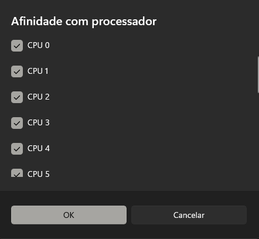
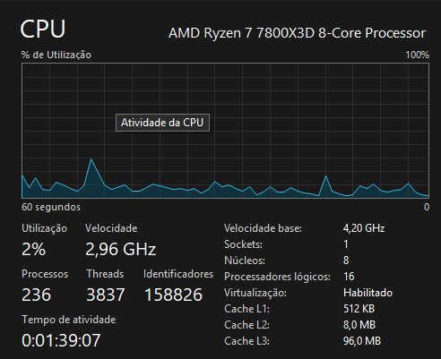
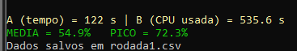
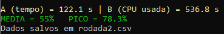
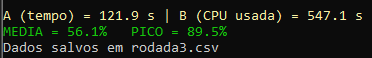
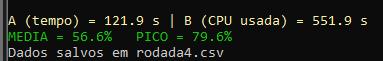
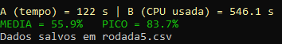

# ME2.1: Utilização média de CPU

Esta página registra quanto o navegador usa de processador enquanto o avatar do VLibras sinaliza sem parar. A métrica foi definida em [Métricas](../fase-2/metricas.md) para responder à questão Q2-E. A coleta seguiu o protocolo de [Método de avaliação](../fase-3/metodo-de-avaliacao.md) e o roteiro "Tradução contínua" da [Massa de dados](../fase-3/massa-de-dados.md).

A Fase 3 prevê duas condições de coleta:

| Condição                         | Dispositivo                                 | Situação     |
| -------------------------------- | ------------------------------------------- | ------------ |
| Simulação de *hardware* limitado | D1 (Ryzen 7 7800X3D, restrito pelo Windows) | **Coletada** |
| *Hardware* modesto real          | D3 (Core i7-7700HQ, 2017)                   | Prevista     |

Por enquanto, só a simulação feita no D1 foi coletada. A simulação foi necessária porque o processador do D1 é de alto desempenho e não se parece com o de um aparelho de entrada. O julgamento desta página vale para essa condição e será revisto depois da coleta no D3.

> Resultado parcial (simulação no D1): uso médio de CPU de **55,7%** e pico de **89,5%**, num computador comum simulado com 4 núcleos, 8 *threads* e sem aceleração gráfica. Pelos critérios da Fase 2, o nível é **Ruim**, e a hipótese H2-E se confirma quanto ao uso de CPU.

## Ficha da medição

| Campo | Valor |
| ----- | ----- |
| Métrica | ME2.1: Utilização média de CPU |
| Característica | Eficiência de Desempenho (ISO/IEC 25010:2023) |
| Questão | Q2-E: Qual é o consumo de processamento (CPU) do navegador durante a renderização contínua do avatar em dispositivos com recursos de *hardware* limitados? |
| Hipótese | H2-E: Em *hardware* modesto, a renderização contínua do avatar eleva o uso de CPU do navegador para mais de 50% ([Hipóteses](../fase-2/hipoteses.md)) |
| Objeto | Widget VLibras publicado, versão 7.12.2, carregado na página de teste pelo código padrão de instalação |
| Condição | Simulação de *hardware* limitado no D1. A coleta no D3 ainda será feita |
| Data | 16/11/2026 |
| Responsável | Amanda C. Lima |

## Ambiente do ensaio

O D1 ([Recursos e ambiente](../fase-3/recursos-e-ambiente.md)) tem um processador de alto desempenho. Para chegar perto de um computador comum, o navegador foi restringido pelo próprio Windows:

| Item                             | Configuração                                                                         |
| -------------------------------- | ------------------------------------------------------------------------------------ |
| Processador de origem            | AMD Ryzen 7 7800X3D (8 núcleos, 16 *threads*), 16 GB de RAM, Windows 11              |
| Núcleos disponíveis ao navegador | CPUs lógicas 0 a 7, ou seja, **4 núcleos físicos e 8 *threads***                     |
| Desempenho máximo do processador | **60%**, velocidade observada de 2,96 GHz, contra 4,20 GHz de base                   |
| Navegador                        | Google Chrome 157.0.8103.79, em janela anônima, com **aceleração gráfica desligada** |
| Demais aplicações                | Fechadas                                                                             |

Quatro núcleos e oito *threads* é o perfil mais comum em notebooks de entrada e intermediários. Com a aceleração gráfica desligada, o avatar (Unity/WebGL) é desenhado pela CPU e não pela placa de vídeo, como aconteceria num aparelho sem GPU dedicada ou com vídeo integrado fraco.

## Como a medida foi obtida

1. A página de teste (`instrumentos/pagina-teste.html`) foi aberta na janela anônima.
2. O widget foi ativado pelo ícone na página, e o bloco com as frases F4 a F8 repetidas foi enviado para tradução.
3. Por volta de 10 s depois de o avatar começar a sinalizar, o script `medir_cpu.ps1` passou a ler, a cada segundo e por 120 s, o tempo de CPU acumulado por todos os processos `chrome.exe`.
4. No fim de cada sessão, o script calculou a média pela fórmula abaixo e guardou o pico entre as amostras de 1 s.
5. Foram 5 sessões, com cerca de 1 minuto de intervalo entre elas.

O script lê os contadores de processo do Windows, os mesmos que o Gerenciador de Tarefas e o Monitor de Desempenho usam. É a fonte de dados prevista para a métrica.

## Fórmula

A ME2.1 é calculada pela fórmula definida em [Métricas](../fase-2/metricas.md):

**X = B / (A × N) × 100**

| Termo | Significado                                                             | Valor nesta coleta          |
| ----- | ----------------------------------------------------------------------- | --------------------------- |
| A     | Tempo total da sessão de tradução, em segundos                          | ≈ 122 s                     |
| B     | Tempo de CPU consumido por todos os processos do navegador, em segundos | 535,6 s a 551,9 s           |
| N     | Número de *threads* disponíveis ao navegador                            | 8                           |
| X     | Utilização média de CPU                                                 | 55,7% (média das 5 sessões) |

Na sessão 1: X = 535,6 / (122,0 × 8) × 100 = **54,9%**.

Aqui, N é o número de *threads* liberadas ao navegador pela afinidade. No D3, sem restrição, N será o total de *threads* do processador (também 8), e X ficará próximo do uso de CPU mostrado pelo Gerenciador de Tarefas.

## Resultados

**Tabela 1.** Consumo de CPU por sessão.

|  Sessão   | A (s) | B (s) | *Threads* ocupadas (B / A) |   Média X |      Pico |    Mínimo |
| :-------: | ----: | ----: | -------------------------: | --------: | --------: | --------: |
|     1     | 122,0 | 535,6 |                       4,39 |     54,9% |     72,3% |     19,9% |
|     2     | 122,1 | 536,8 |                       4,40 |     55,0% |     78,3% |     19,5% |
|     3     | 121,9 | 547,1 |                       4,49 |     56,1% |     89,5% |     19,4% |
|     4     | 121,9 | 551,9 |                       4,53 |     56,6% |     79,6% |     18,9% |
|     5     | 122,0 | 546,1 |                       4,48 |     55,9% |     83,7% |     20,0% |
| **Geral** |       |       |                   **4,46** | **55,7%** | **89,5%** | **18,9%** |

Fonte: elaborado pelos autores, a partir dos CSVs da coleta. Desvio padrão da média entre sessões: 0,73 p.p.

**Tabela 2.** Distribuição das 600 amostras de 1 s pelas faixas da métrica.

| Faixa                           | Amostras | Proporção |
| ------------------------------- | -------: | --------: |
| ≤ 30% (Satisfatório / Ideal)    |       24 |      4,0% |
| 31% a 50% (Aceitável / Regular) |       85 |     14,2% |
| &gt; 50% (Ruim)                 |      491 |     81,8% |

Fonte: elaborado pelos autores.

Nos [critérios de pontuação](../fase-2/pontuacao-e-criterios.md), média acima de 50% é nível Ruim (1 a 2). As cinco sessões ficaram nessa faixa, e a menor média foi 54,9%.

## Análise

- O consumo foi alto em todas as sessões. Em 82% dos segundos medidos, o navegador usou mais da metade da capacidade disponível.
- O pico de 89,5% deixa pouca folga para outras tarefas. Num computador de uso real, que divide a CPU com antivírus, outras abas e o sistema, isso tende a aparecer como animação truncada ou travamento.
- O navegador ocupou em média 4,46 *threads* inteiras, mais da metade das 8 disponíveis.
- A hipótese H2-E se confirma nesta condição, quanto ao uso de CPU: a média passou de 50% em todas as sessões. A outra parte da hipótese, a queda para menos de 20 FPS, não foi medida. Para uma conclusão definitiva, falta a coleta no D3.
- Julgamento parcial: na simulação no D1, a ME2.1 fica no nível **Ruim** (X = 55,7%). Num computador comum sem ajuda da placa de vídeo, o avatar sinalizando sem parar usa mais da metade do processador.

## Evidências

**Figura 1.** Afinidade do processo `chrome.exe`, com as CPUs lógicas 0 a 7 marcadas (a lista continua abaixo do trecho visível). Fonte: elaborado pelos autores.

**Figura 2.** Gerenciador de Tarefas com o limite de 60% aplicado: velocidade de 2,96 GHz, para uma base de 4,20 GHz. Fonte: elaborado pelos autores.

**Figura 3.** Saída do script no fim das cinco sessões, com A, B, média e pico. Fonte: elaborado pelos autores.

Os arquivos originais estão em [Dados brutos da ME2.1](./dados-brutos/ME2.1/README.md).

## Limitações e próximos passos

- A Fase 3 previa o DevTools tanto para simular o *hardware* limitado (*throttling* de 4x) quanto para medir o consumo (*Performance Monitor*). As duas ferramentas, porém, atuam apenas sobre o processo da página inspecionada e não alcançam os processos responsáveis pela renderização do avatar e pela GPU. Na preparação, o *Performance Monitor* chegou a registrar uso de CPU próximo de 0% com o avatar sinalizando. Por isso, o processador foi limitado pelo Windows e a medição passou a ser feita pelo script, que soma o tempo de CPU de todos os processos do navegador.
- A simulação no D1 não reproduz tudo de um computador comum devido ao hardware.
- Como o resultado depende do número de *threads* disponíveis, cada resultado deve vir com o seu N, para que as condições possam ser comparadas.

## Referências

> ISO/IEC. **ISO/IEC 25010:2023**: systems and software engineering: systems and software quality requirements and evaluation (SQuaRE): product quality model. 2. ed. Geneva: ISO/IEC, 2023.

## Histórico de Versões

| Versão | Data       | Descrição da alteração                                   | Autor(a)       | Revisor(a) |
| ------ | ---------- | -------------------------------------------------------- | -------------- | ---------- |
| 0.1    | 16/11/2026 | Registro da coleta e do julgamento da ME2.1              | Amanda C. Lima |            |
