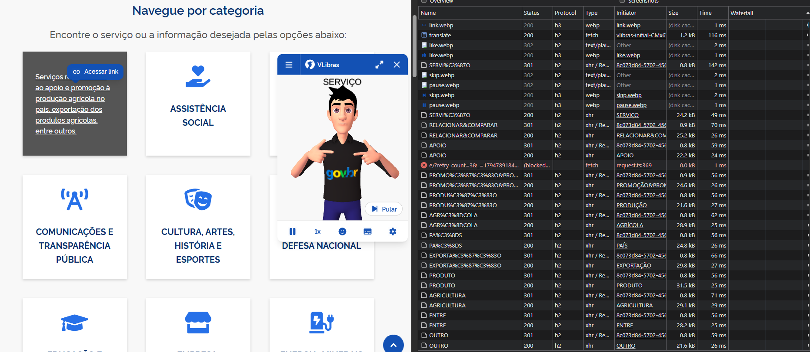
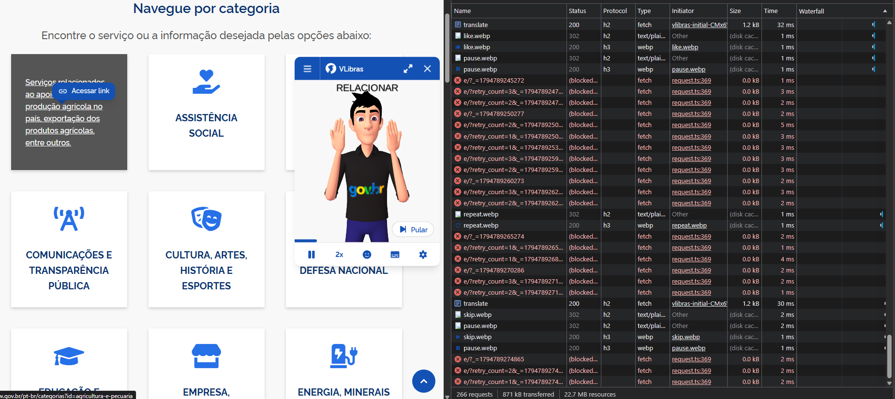
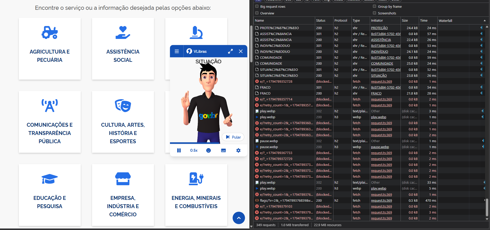
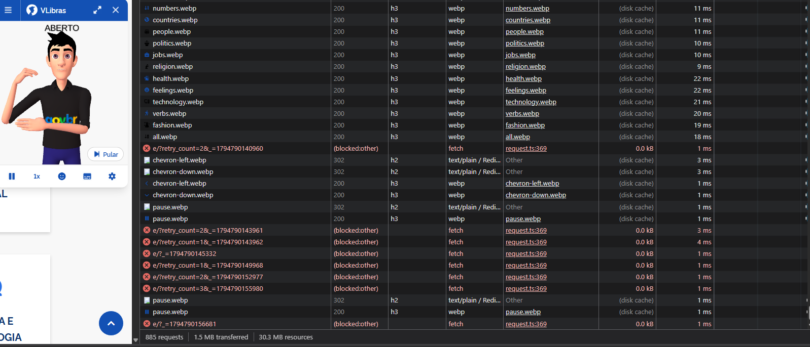
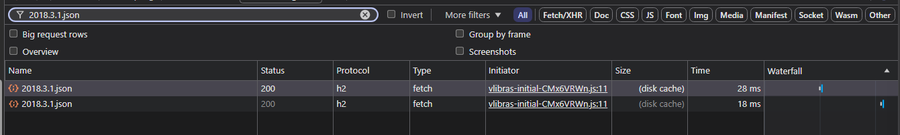
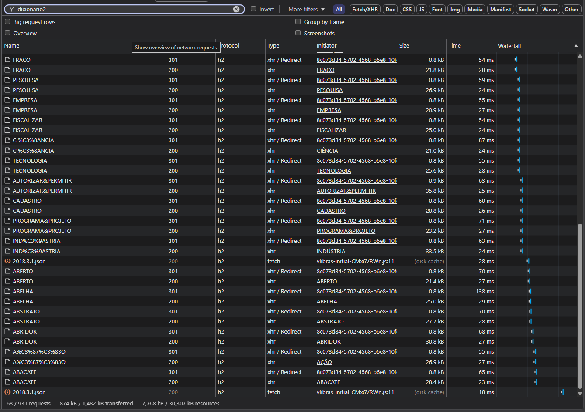

# ME3.1: Teste complementar em um portal real (gov.br)

Esta página registra um teste complementar da métrica ME3.1, feito no portal `www.gov.br/pt-br`, que já traz o VLibras embutido. Ele **não segue o protocolo padronizado** da [Fase 3](../fase-3/metodo-de-avaliacao.md) (página de teste com as 10 frases padronizadas): usa textos e termos do próprio portal. O resultado oficial da métrica está em [ME3.1 – Volume de dados e reuso do cache](./me3-1-volume-de-dados-e-cache.md); este teste fica disponível para consulta, para mostrar o comportamento do widget em uso real. A página segue as três atividades da Fase 4: obter a medida, comparar com o critério e julgar o resultado (Aula A07, slide 20).

## Identificação da medição

**Tabela 1.** Identificação da medição.

| Item | Registro |
| ---- | -------- |
| Característica | Eficiência de Desempenho |
| Questão | Q3-E – Qual é o volume de dados de rede consumido ao utilizar os recursos de repetição de vídeo, alteração de velocidade e consulta ao dicionário? |
| Hipótese | H3-E – As ações de repetição e alteração de velocidade de um trecho já traduzido reutilizam o cache local em 100% dos casos, sem tráfego adicional na rede ([Hipóteses](../fase-2/hipoteses.md)) |
| Cálculo | X = (A / B) × 100, com A = requisições da reexecução atendidas pelo cache local e B = total de requisições disparadas pelas ações da reexecução |
| Data da coleta | 15/11/2026, das 21:31 às 21:53 (horário de Brasília) |
| Responsável | Geovane S. Freitas |

## 1. Obter a medida

A coleta foi feita no portal `www.gov.br/pt-br`, que já traz o widget embutido, com a aba *Network* do DevTools aberta (*Keep log* ligado, *Disable cache* desligado, sem limitação de rede). O roteiro foi executado duas vezes na mesma sessão:

- **1ª execução:** traduzir 4 descrições de cartões da seção "Navegue por categoria" e buscar 6 termos no dicionário (ABERTO, ABELHA, ABSTRATO, ABRIDOR, AÇÃO e ABACATE);
- **reexecução:** reproduzir de novo os mesmos textos, trocando a velocidade (0.5x, 1x e 2x), pausando e repetindo o trecho, e reabrir o dicionário para reproduzir de novo o termo ABERTO.

Ao final, o registro da aba *Network* foi exportado em HAR e classificado por um script, que separa a 1ª execução da reexecução e conta, em cada uma, as requisições atendidas pelo cache e as que foram para a rede.

**Tabela 2.** Resultado por ação.

| Ação | 1ª execução: requisições (rede / cache) | 1ª execução: bytes | Reexecução: requisições (rede / cache) | Reexecução: bytes |
| ---- | :-------------------------------------: | -----------------: | :------------------------------------: | ----------------: |
| Texto 1 (Agricultura e Pecuária) | 47 (25 / 22) | 322.876 | 18 (2 / 16) | 2.332 |
| Texto 2 (Assistência Social) | 25 (13 / 12) | 147.696 | 5 (1 / 4) | 1.151 |
| Texto 3 (Pesquisa e ciência) | 19 (11 / 8) | 124.744 | 10 (2 / 8) | 2.305 |
| Texto 4 (Autorizações) | 13 (9 / 4) | 117.737 | 9 (1 / 8) | 1.144 |
| Dicionário | 179 (26 / 153) | 204.764 | 143 (2 / 141) | 10.607 |
| **Total** | **283 (84 / 199)** | **917.817 (≈ 918 kB)** | **185 (8 / 177)** | **17.539 (≈ 17,5 kB)** |

Fonte: elaborado pelos autores, a partir do HAR da coleta. Bytes = coluna *Size* da aba *Network*.

**Tabela 3.** Requisições da reexecução que foram para a rede (8 de 185).

| Requisição | Quantidade | Bytes | Motivo |
| ---------- | ---------: | ----: | ------ |
| `POST traducao2.vlibras.gov.br/translate` | 6 | 6.932 | O texto é reenviado ao tradutor a cada nova reprodução; a tradução não fica em cache local |
| `GET repositorio.vlibras.gov.br/api/tags` | 1 | 2.558 | Lista de categorias do dicionário, pedida de novo ao reabrir o dicionário depois de 5 minutos |
| `GET repositorio.vlibras.gov.br/api/tagsigns?tag=ADJETIVOS` | 1 | 8.049 | Lista de sinais da categoria, pedida de novo pelo mesmo motivo |

Fonte: elaborado pelos autores.

As outras 177 requisições da reexecução foram ícones da interface, o índice do dicionário e redirecionamentos, todos lidos do cache de disco. Nenhum sinal já baixado foi baixado de novo, nem nas frases nem no dicionário.

**Medida obtida:** X = 177 / 185 × 100 = **95,7 %**.

## 2. Comparar com o critério

**Tabela 4.** Comparação com os níveis de pontuação da ME3.1.

| Nível | Faixa ([Pontuação e critérios](../fase-2/pontuacao-e-criterios.md)) | Resultado |
| ----- | ------------------------------------------------------------------- | --------- |
| Ruim (1 a 2) | &lt; 80 % | |
| Aceitável/Regular (3) | 80 % a 94 % | |
| Satisfatório/Ideal (4 a 5) | ≥ 95 % | **95,7 %** |

Fonte: elaborado pelos autores.

O resultado fica no nível **Satisfatório/Ideal**, perto do limite: com 2 requisições pela rede a mais na reexecução, X cairia para 94,7 % (Aceitável/Regular). Separando as ações, as de tradução (repetir, velocidade e pausa) ficaram em 36 / 42 = 85,7 % e as do dicionário em 141 / 143 = 98,6 %.

## 3. Julgar o resultado

1. **Velocidade, pausa e repetição reaproveitam os sinais.** Nenhuma dessas ações baixou sinais de novo: os sinais da frase ficam na memória do *player* e os ícones vêm do cache de disco (Figura 2). Trocar a velocidade durante a reprodução, sozinho, não gerou nova chamada ao tradutor (Figura 3).
2. **A tradução é sempre pedida de novo.** Cada nova reprodução de um texto já traduzido reenviou o texto ao serviço de tradução (≈ 1,15 kB por vez). É a principal causa de tráfego na reexecução.
3. **O dicionário reaproveita o índice e os sinais.** O índice do dicionário (`2018.3.1.json`, 3,47 MB) e o sinal ABERTO não foram baixados de novo (Figuras 4 e 5). Só as listas de categorias e de sinais foram pedidas de novo, porque o widget guarda esses dados em memória por 5 minutos e a reabertura aconteceu quase 10 minutos depois da primeira.
4. **Sinais compartilhados entre textos.** Os textos começam com "Serviços relacionados…", e vários terminam com "…entre outros". Os sinais SERVIÇO, RELACIONAR&COMPARAR, ENTRE e OUTRO só foram baixados uma vez na sessão (Figura 6).
5. **Hipótese H3-E: confirmada em parte.** Sinais e ícones foram 100 % reaproveitados nas ações repetidas, mas houve tráfego adicional, por causa do reenvio do texto ao tradutor. Em volume, a reexecução consumiu 17,5 kB, contra 918 kB da 1ª execução (98,1 % a menos).

**Julgamento:** a ME3.1 atende ao critério de qualidade definido pela equipe (X = 95,7 %, Satisfatório/Ideal). O ponto de melhoria observado é guardar localmente o resultado da tradução de um trecho, o que eliminaria a maior parte do tráfego restante.

## Evidências

**Figura 1.** 1ª tradução do texto 1: o texto vai ao tradutor e cada sinal é baixado (redirecionamento 301 e arquivo). Fonte: elaborado pelos autores.

**Figura 2.** Reexecução do texto 1 a 2x: só o texto vai de novo ao tradutor; os ícones vêm do cache de disco e nenhum sinal é baixado. Fonte: elaborado pelos autores.

**Figura 3.** Troca de velocidade para 0.5x durante a reprodução do texto 2, sem nova chamada ao tradutor. Fonte: elaborado pelos autores.

**Figura 4.** Reexecução no dicionário: o termo ABERTO é reproduzido de novo sem nova requisição do sinal. Fonte: elaborado pelos autores.

**Figura 5.** Índice do dicionário (`2018.3.1.json`) pedido duas vezes, as duas atendidas pelo cache de disco. Fonte: elaborado pelos autores.

**Figura 6.** Requisições ao servidor de sinais no fim do registro: cada sinal aparece uma única vez (68 requisições, 874 kB). Fonte: elaborado pelos autores.

Os dados completos estão em [Dados brutos da ME3.1 — gov.br](./dados-brutos/ME3.1/govbr/README.md):

- `resultado.md`: registro detalhado da coleta, ambiente, procedimento, critérios e limitações;
- `brutos/ME3.1_govbr_2026-11-15.har`: HAR exportado da aba *Network*;
- `requisicoes_classificadas.csv`: requisições classificadas por ação, execução, cache/rede e bytes;
- `ME3.1_calculo.py`: script de recálculo a partir do HAR;
- `prints/`: 27 capturas originais da aba *Network*.

## Diferenças em relação à coleta padronizada

**Tabela 5.** Diferenças entre este teste e o protocolo da Fase 3.

| Item | Protocolo (Fase 3) | Este teste |
| ---- | ------------------ | ---------- |
| Página | Página de teste com as 10 frases padronizadas | `www.gov.br/pt-br` (portal P1 da amostra), com o widget já embutido |
| Textos traduzidos | F1 a F10 | 4 descrições de cartões da seção "Navegue por categoria" |
| Termos do dicionário | protocolo, benefício, prazo, comprovante e requerente | ABERTO, ABELHA, ABSTRATO, ABRIDOR, AÇÃO e ABACATE, cada um de uma categoria do dicionário |
| Cache | Arquivos em cache do navegador limpos antes | Só os dados do site gov.br foram apagados |

Fonte: elaborado pelos autores.

## Limitações

- **Arquivos já em cache na 1ª execução.** Mesmo com os dados do site gov.br apagados antes da coleta, o índice do dicionário (3,47 MB) e quase todos os arquivos do widget vieram do cache de disco já na 1ª execução. O navegador guarda o cache separado por site principal, e os arquivos do VLibras usados no gov.br continuaram guardados. Por isso, a 1ª execução mostra menos dados do que um primeiro uso real. Isso não muda X, que é calculado na reexecução.
- **Telemetria bloqueada.** O navegador usado (Brave) bloqueia por padrão os envios de telemetria do widget (PostHog), que ficaram fora do cálculo. Se entrassem em B, X cairia para 52,4 %.
- **Corte entre 1ª execução e reexecução.** Pausas e trocas de velocidade feitas durante a primeira reprodução de cada texto contaram na 1ª execução. Contadas na reexecução, X subiria no máximo para 96,5 %.

## Participação na coleta

| Integrante | Contribuição |
| ---------- | ------------ |
| Geovane S. Freitas | Responsável pela coleta complementar no gov.br e pelo registro das evidências da ME3.1. |

## Referências

> RAMOS, Cristiane Soares. **Aula A07: Processo de Avaliação de Produto**. Slides da disciplina Qualidade de Software 1. Brasília: Universidade de Brasília, 2026.

> ISO/IEC. **ISO/IEC 25010:2023**: systems and software engineering: systems and software quality requirements and evaluation (SQuaRE): product quality model. 2. ed. Geneva: ISO/IEC, 2023.

## Histórico de Versões

| Versão | Data       | Descrição da alteração                         | Autor(a)           | Revisor(a) |
| ------ | ---------- | ---------------------------------------------- | ------------------ | ---------- |
| 0.1    | 15/11/2026 | Registro da execução e do julgamento da ME3.1 | Geovane S. Freitas |            |
| 0.2    | 15/11/2026 | Organização e vinculação dos dados brutos da coleta | Rafael W. Schadt |            |
