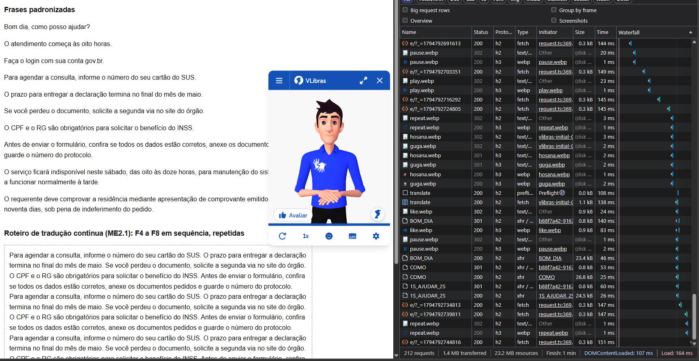
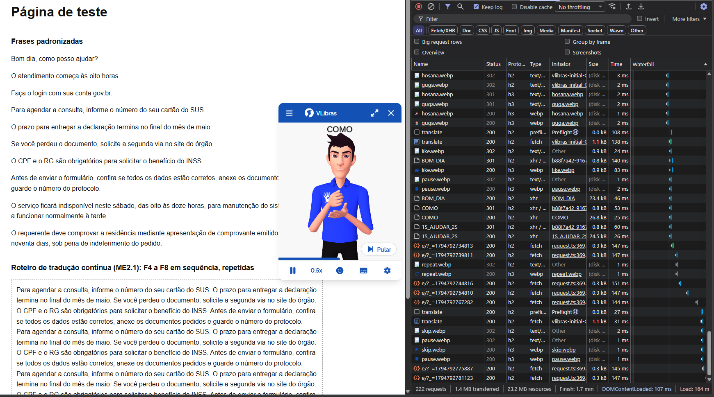
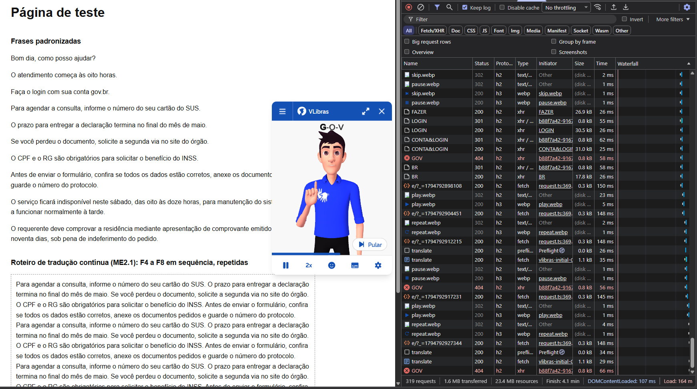
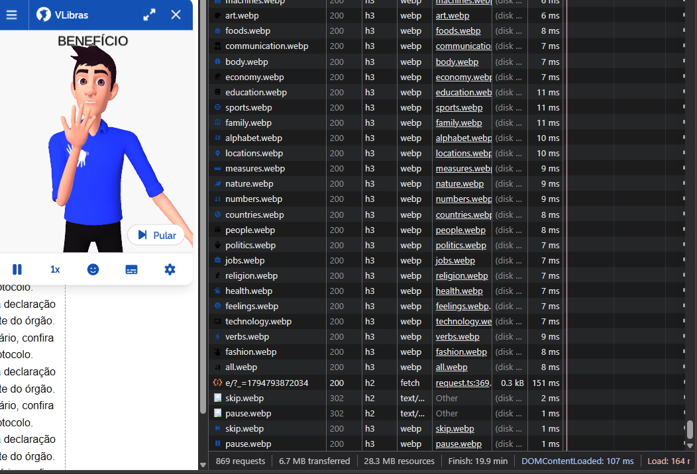
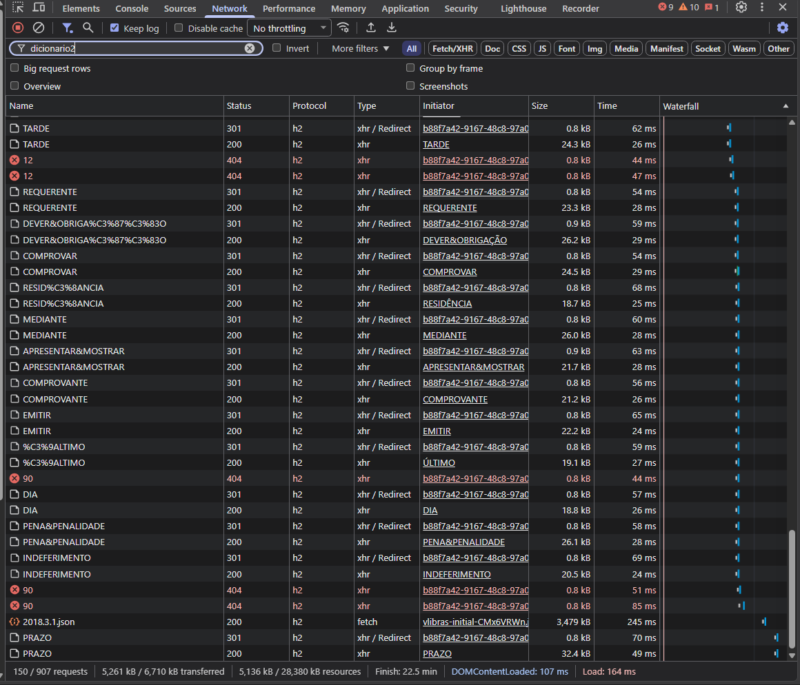

# ME3.1: Volume de dados consumidos e taxa de reuso do cache

Esta página registra a execução da métrica ME3.1, definida em [Métricas](../fase-2/metricas.md), seguindo o protocolo de [Método de avaliação](../fase-3/metodo-de-avaliacao.md) e o roteiro "Rede e cache" de [Massa de dados](../fase-3/massa-de-dados.md). Ela segue as três atividades da Fase 4: obter a medida, comparar com o critério e julgar o resultado (Aula A07, slide 20).

Um teste complementar, feito em um portal real (`www.gov.br`) e fora deste protocolo, está disponível para consulta em [ME3.1 – Teste complementar no gov.br](./me3-1-govbr.md).

**Tabela 1.** Identificação da métrica.

| Item | Registro |
| ---- | -------- |
| Característica | Eficiência de Desempenho |
| Questão | Q3-E – Qual é o volume de dados de rede consumido ao utilizar os recursos de repetição de vídeo, alteração de velocidade e consulta ao dicionário? |
| Hipótese | H3-E – As ações de repetição e alteração de velocidade de um trecho já traduzido reutilizam o cache local em 100% dos casos, sem tráfego adicional na rede ([Hipóteses](../fase-2/hipoteses.md)) |
| Cálculo | X = (A / B) × 100, com A = requisições da reexecução atendidas pelo cache local e B = total de requisições disparadas pelas ações da reexecução |
| Data da coleta | 15/11/2026, das 22:31 às 22:56 |
| Responsável | Geovane S. Freitas |

## 1. Obter a medida

A coleta foi feita na página de teste (`instrumentos/pagina-teste.html`), com os arquivos em cache do navegador limpos antes e a aba *Network* do DevTools aberta (*Keep log* ligado, *Disable cache* desligado, sem limitação de rede):

- **1ª execução:** traduzir as 10 frases padronizadas (F1 a F10) a 1x e consultar no dicionário os 5 termos da massa de dados (protocolo, benefício, prazo, comprovante e requerente);
- **reexecução:** reproduzir de novo cada frase já traduzida, a 0.5x e a 2x, com o botão "Repetir" (21 reproduções).

O registro da aba *Network* foi exportado em HAR e classificado por um script, que separa a 1ª execução da reexecução pelo texto enviado ao tradutor e conta as requisições atendidas pelo cache e as que foram para a rede.

**Tabela 2.** Resultado por execução.

| Execução | Requisições | Pela rede | Pelo cache | Dados pela rede |
| -------- | ----------: | --------: | ---------: | --------------: |
| 1ª execução: tradução das 10 frases | 225 | 163 | 62 | 1.756.900 B |
| 1ª execução: dicionário (5 termos) | 162 | 76 | 86 | 3.590.152 B |
| **1ª execução (total)** | **387** | **239** | **148** | **≈ 5,35 MB** |
| **Reexecução (21 reproduções)** | **202** | **48** | **154** | **≈ 28,1 kB** |

Fonte: elaborado pelos autores, a partir do HAR da coleta. Bytes = coluna *Size* da aba *Network*.

**Tabela 3.** Requisições da reexecução que foram para a rede (48 de 202).

| Requisição | Quantidade | Bytes | Motivo |
| ---------- | ---------: | ----: | ------ |
| `POST traducao2.vlibras.gov.br/translate` | 21 | 23.203 | O texto é reenviado ao tradutor a cada nova reprodução; a tradução não fica em cache local |
| `OPTIONS traducao2.vlibras.gov.br/translate` | 21 | 0 | Verificação CORS (*preflight*) que o navegador faz antes de cada `POST` |
| `GET dicionario2…/GOV`, `…/12` e `…/90` | 6 | 4.870 | Sinais que não existem no servidor (erro 404), pedidos de novo a cada reprodução |

Fonte: elaborado pelos autores.

As outras 154 requisições da reexecução foram ícones da interface, lidos do cache de disco. Nenhum sinal já baixado foi baixado de novo.

**Medida obtida:** X = 154 / 202 × 100 = **76,2 %**.

## 2. Comparar com o critério

**Tabela 4.** Comparação com os níveis de pontuação da ME3.1.

| Nível | Faixa ([Pontuação e critérios](../fase-2/pontuacao-e-criterios.md)) | Resultado |
| ----- | ------------------------------------------------------------------- | --------- |
| Ruim (1 a 2) | &lt; 80 % | **76,2 %** |
| Aceitável/Regular (3) | 80 % a 94 % | |
| Satisfatório/Ideal (4 a 5) | ≥ 95 % | |

Fonte: elaborado pelos autores.

**Tabela 5.** Sensibilidade do resultado.

| Cenário | A / B | X | Nível |
| ------- | ----- | - | ----- |
| Todas as requisições da reexecução (resultado oficial) | 154 / 202 | 76,2 % | Ruim |
| Sem as verificações CORS (`OPTIONS`) | 154 / 181 | 85,1 % | Aceitável/Regular |
| Sem as verificações CORS e sem os sinais inexistentes (404) | 154 / 175 | 88,0 % | Aceitável/Regular |
| Incluindo a telemetria do widget em B | 154 / 257 | 59,9 % | Ruim |

Fonte: elaborado pelos autores.

## 3. Julgar o resultado

1. **Velocidade e repetição reaproveitam os sinais.** Em nenhuma das 21 reproduções repetidas um sinal já baixado foi pedido de novo: os sinais ficam na memória do *player* e os ícones vêm do cache de disco (Figuras 1 e 2).
2. **A tradução não é guardada localmente.** Cada reprodução repetida reenvia o texto ao tradutor (≈ 1,1 kB) e, antes dele, o navegador faz uma verificação CORS. Essas duas requisições respondem por 42 das 48 requisições pela rede da reexecução.
3. **Sinais inexistentes são pedidos de novo.** GOV (F3), 12 (F9) e 90 (F10) retornam erro 404 e são pedidos a cada reprodução, e o avatar soletra a palavra (Figura 3).
4. **O dicionário reaproveita os sinais já carregados.** Dos 5 termos, 4 já tinham sido baixados nas frases (BENEFÍCIO, PROTOCOLO, COMPROVANTE e REQUERENTE) e foram reproduzidos sem nenhuma requisição; só PRAZO foi baixado (Figuras 4 e 5). O maior volume do roteiro é o índice do dicionário (3,48 MB), baixado uma vez na abertura.
5. **Hipótese H3-E: não confirmada.** Sinais e ícones foram 100 % reaproveitados, mas toda reprodução repetida gerou tráfego adicional. Em volume, esse tráfego é pequeno: 28,1 kB na reexecução, contra 5,35 MB na 1ª execução (99,5 % a menos).

**Julgamento:** pela fórmula definida na Fase 2, a ME3.1 fica no nível **Ruim** (X = 76,2 %). O widget reaproveita bem os arquivos pesados (sinais, ícones e índice do dicionário), e o volume de dados nas ações repetidas é baixo. O que reprova a métrica é a quantidade de requisições, não o volume: o resultado da tradução não é guardado localmente. Guardar a tradução de um trecho já traduzido eliminaria 42 das 48 requisições pela rede da reexecução.

O [teste complementar no gov.br](./me3-1-govbr.md) chegou a X = 95,7 %. Lá, as verificações CORS não apareceram, o que indica que parte da diferença vem da origem da página: a página de teste é aberta como arquivo local.

## Evidências

**Figura 1.** 1ª tradução da F1 (1x): o texto vai ao tradutor e cada sinal é baixado (redirecionamento 301 e arquivo). Fonte: elaborado pelos autores.

**Figura 2.** Reexecução da F1 a 0.5x: só a verificação CORS e o texto vão de novo à rede; os ícones vêm do cache de disco e nenhum sinal é baixado. Fonte: elaborado pelos autores.

**Figura 3.** Reexecução da F3 a 2x: o sinal GOV, inexistente no servidor, é pedido de novo (404). Fonte: elaborado pelos autores.

**Figura 4.** Consulta de BENEFÍCIO no dicionário: o sinal, já carregado na F7, é reproduzido sem nova requisição. Fonte: elaborado pelos autores.

**Figura 5.** Requisições ao servidor de sinais no fim do registro: 150 requisições e 5.261 kB, incluindo o índice do dicionário (3.479 kB) e o único sinal baixado no dicionário (PRAZO). Fonte: elaborado pelos autores.

Os dados completos estão em [Dados brutos da ME3.1 — coleta padronizada](./dados-brutos/ME3.1/padronizado/README.md):

- `resultado.md`: registro detalhado da coleta, resultados por frase, ambiente, procedimento e limitações;
- `brutos/ME3.1_Padronizado_2026-11-15.har`: HAR exportado da aba *Network*;
- `requisicoes_classificadas.csv`: requisições classificadas por ação, execução, cache/rede e bytes;
- `ME3.1_calculo.py`: script de recálculo a partir do HAR;
- `prints/`: 39 capturas originais da aba *Network*.

## Limitações

- **Telemetria.** Na página local, os envios periódicos de telemetria do widget (≈ 0,3 kB a cada 5 s) não foram bloqueados pelo navegador. Eles ficaram fora do cálculo por não dependerem da ação executada (Tabela 5).
- **Verificação CORS.** As requisições `OPTIONS` são feitas pelo navegador e dependem da origem da página. Foram mantidas em B porque são disparadas pelas ações da reexecução (Tabela 5).
- **Uma única sessão.** Para média e variação, o roteiro pode ser repetido em outros dias, navegadores e redes.

## Referências

> RAMOS, Cristiane Soares. **Aula A07: Processo de Avaliação de Produto**. Slides da disciplina Qualidade de Software 1. Brasília: Universidade de Brasília, 2026.

> ISO/IEC. **ISO/IEC 25010:2023**: systems and software engineering: systems and software quality requirements and evaluation (SQuaRE): product quality model. 2. ed. Geneva: ISO/IEC, 2023.

## Histórico de Versões

| Versão | Data       | Descrição da alteração                                    | Autor(a)           | Revisor(a) |
| ------ | ---------- | --------------------------------------------------------- | ------------------ | ---------- |
| 0.1    | 15/11/2026 | Registro da execução padronizada e do julgamento da ME3.1 | Geovane S. Freitas |            |
