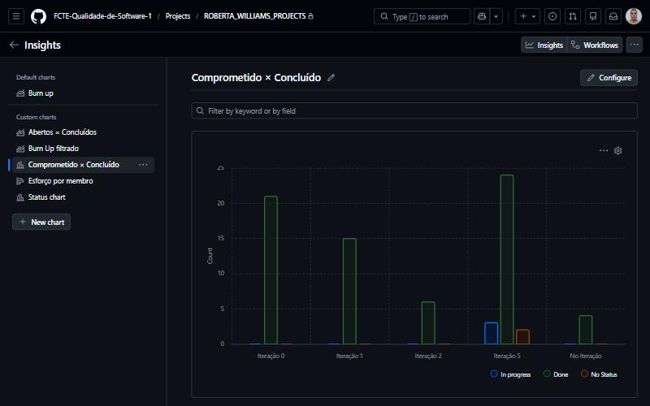
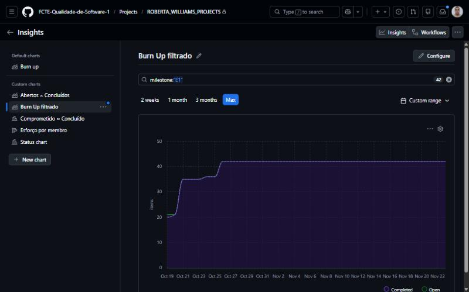
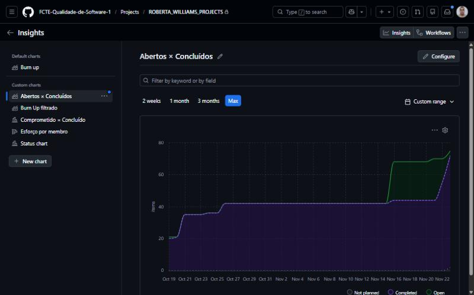
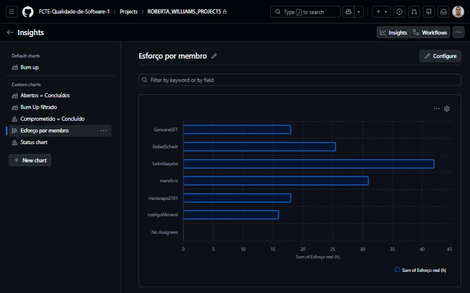

# Registro de medições

Cada iteração tem uma tabela com o valor de cada indicador, a interpretação pelo critério de decisão e a decisão tomada. A definição de cada indicador está em [Indicadores](./indicadores.md).

Os valores foram extraídos do GitHub Projects da equipe (ROBERTA_WILLIAMS_PROJECTS) em 22/11/2026. Nos indicadores 1, 2, 5 e 6 contam só os itens sem pai; nos indicadores 3 e 4, só os itens concluídos com horas registradas (as *issues*-mãe não têm horas).

## Iterações

| Iteração   | Período                 | Marco                                  |
| ---------- | ----------------------- | -------------------------------------- |
| Iteração 0 | 12/10/2026 a 18/10/2026 | Cadastrada retroativamente             |
| Iteração 1 | 19/10/2026 a 25/10/2026 | Entrega 1 em 26/10/2026                |
| Iteração 2 | 26/10/2026 a 01/11/2026 | -                                      |
| Iteração 3 | 02/11/2026 a 08/11/2026 | -                                      |
| Iteração 4 | 09/11/2026 a 15/11/2026 | -                                      |
| Iteração 5 | 16/11/2026 a 22/11/2026 | Entrega 2 e apresentação em 23/11/2026 |

## Iteração 0 (12/10 a 18/10/2026)

:::note Iteração cadastrada retroativamente
A Iteração 0 foi cadastrada no GitHub Projects depois de terminada, portanto datas de início e conclusão não devem ser consideradas. As horas reais foram estimadas depois. Essas limitações valem para todos os valores abaixo.
:::

| # | Indicador | Valor | Interpretação (critério de decisão) | Decisão |
| - | --------- | ----- | ----------------------------------- | ------- |
| 1 | Comprometido × concluído | Não se aplica | Não houve compromisso registrado no início da iteração | Registrar o compromisso a partir da Iteração 1 |
| 2 | *Burn-up* E1 | Não se aplica | Os itens da E1 foram cadastrados em 19/10, depois do fim da iteração | Acompanhar o *burn-up* a partir da Iteração 1 |
| 3 | Precisão da estimativa | Não se aplica | Não houve estimativa feita antes da execução; a razão real ÷ estimado (46 ÷ 33 = 139%) não tem significado | Estimar as horas na criação de cada item a partir da Iteração 1 |
| 4 | Esforço por membro | Ver tabela abaixo (total 46 h) | Participações entre 13,0% e 21,7%: dentro da faixa de 10% a 25% | Nenhuma |
| 5 | *Cycle time* médio | 3,9 dias (11 itens) | Limite (média + 10%) = 4,3 dias. Acima: #1, #2, #7 e #18 | Dividir itens maiores em *sub-issues* menores |
| 6 | Fluxo cumulativo | Não se aplica | A contagem por coluna começa na Iteração 1 | - |

### Esforço por membro (indicador 4)

| Membro             | Esforço real (h) | Participação (%) |
| ------------------ | ---------------: | ---------------: |
| Amanda C. Lima     |                6 |             13,0 |
| Geovane S. Freitas |               10 |             21,7 |
| Ludmila O. Nunes   |                9 |             19,6 |
| Mariana P. Silva   |                6 |             13,0 |
| Rafael W. Schadt   |                8 |             17,4 |
| Rodrigo F. Amaral  |                7 |             15,2 |
| **Total**          |           **46** |          **100** |

### *Cycle time* (indicador 5)

| Item (*issue*) | Início | Conclusão | *Cycle time* (dias) | Acima de média + 10%? |
| -------------- | ------ | --------- | ------------------: | :-------------------: |
| #1 Definir produto, escopo, contexto de uso e propósito | 20/10 | 26/10 | 7 | Sim |
| #2 Selecionar as características de qualidade e justificar | 19/08 | 26/08 | 8 | Sim |
| #3 Brainstorming: objetivos estratégicos, problemas e objetivos de melhoria | 15/10 | 17/10 | 3 | Não |
| #4 Definir objetivos GQM | 17/10 | 17/10 | 1 | Não |
| #5 Definir questões e hipóteses | 15/10 | 17/10 | 3 | Não |
| #6 Definir métricas | 17/10 | 17/10 | 1 | Não |
| #7 Artigo: Referencial teórico | 14/10 | 18/10 | 5 | Sim |
| #8 Artigo: Metodologia – Fase 1 | 15/10 | 18/10 | 4 | Não |
| #9 Slides do ponto de controle | 18/10 | 20/10 | 3 | Não |
| #18 Configurar o GitHub Projects conforme PSM/CID | 14/10 | 18/10 | 5 | Sim |
| #19 Estruturação do GitPages | 18/10 | 20/10 | 3 | Não |

Média 3,9 dias; limite 4,3 dias.

## Iteração 1 (19/10 a 25/10/2026)

| #   | Indicador                | Valor                      | Interpretação (critério de decisão) | Decisão |
| --- | ------------------------ | -------------------------- | ----------------------------------- | ------- |
| 1   | Comprometido × concluído | C = 3; D = 3; D ÷ C = 100% | Desvio 0%: dentro do limite de 5% (*On track*) | Manter o ritmo |
| 2   | *Burn-up* E1             | Em aberto = 1 de 14 (#1)   | O item em aberto é a consolidação da Fase 1, concluída em 26/10, no dia da entrega | Concluir a consolidação no dia da entrega |
| 3   | Precisão da estimativa   | R ÷ E = 29 ÷ 28 = 104%     | Dentro da faixa de 80% a 120% | Manter a forma de estimar |
| 4   | Esforço por membro       | Ver tabela abaixo (total 29 h) | Participações entre 13,8% e 24,1%: dentro da faixa | Nenhuma |
| 5   | *Cycle time* médio       | 1,0 dia (3 itens)          | Nenhum item acima do limite (1,1 dia) | Nenhuma |
| 6   | Fluxo cumulativo         | Ver contagens abaixo       | 1 item em andamento nas duas contagens: sem acúmulo | Nenhuma |

### Esforço por membro (indicador 4)

| Membro             | Esforço real (h) | Participação (%) |
| ------------------ | ---------------: | ---------------: |
| Amanda C. Lima     |                4 |             13,8 |
| Geovane S. Freitas |                4 |             13,8 |
| Ludmila O. Nunes   |                6 |             20,7 |
| Mariana P. Silva   |                7 |             24,1 |
| Rafael W. Schadt   |                4 |             13,8 |
| Rodrigo F. Amaral  |                4 |             13,8 |
| **Total**          |           **29** |          **100** |

### *Cycle time* (indicador 5)

| Item (*issue*) | Início | Conclusão | *Cycle time* (dias) | Acima de média + 10%? |
| -------------- | ------ | --------- | ------------------: | :-------------------: |
| #36 Elaborar e organizar atas das reuniões até 20/10/26 | 21/10 | 21/10 | 1 | Não |
| #37 Artigo: Metodologia – Fase 2 | 18/10 | 18/10 | 1 | Não |
| #38 Artigo: Introdução | 23/10 | 23/10 | 1 | Não |

Média 1,0 dia; limite 1,1 dia.

## Iteração 2 (26/10 a 01/11/2026)

| # | Indicador | Valor | Interpretação (critério de decisão) | Decisão |
| - | --------- | ----- | ----------------------------------- | ------- |
| 1 | Comprometido × concluído | C = 6; D = 6; D ÷ C = 100% | Desvio 0% (*On track*) | Manter o ritmo |
| 2 | *Burn-up* E1 | Em aberto = 0 de 20 | E1 entregue no prazo (26/10) | Encerrar o acompanhamento da E1 |
| 3 | Precisão da estimativa | R ÷ E = 10 ÷ 7,5 = 133% | Acima de 120%: as páginas do GitPages foram subestimadas | Rever a estimativa de itens de documentação |
| 4 | Esforço por membro | Ver tabela abaixo (total 10 h) | Amanda (60%) e Ludmila (40%) acima de 25%; os demais sem horas na iteração | Distribuir os itens de GitPages entre mais membros |
| 5 | *Cycle time* médio | 3,5 dias (6 itens) | Limite 3,9 dias. Acima: #39 e #40 | Os dois foram iniciados antes da iteração e cadastrados só em 26/10: cadastrar os itens ao iniciá-los |
| 6 | Fluxo cumulativo | Ver contagens abaixo | Nenhum item em andamento ao fim da iteração | Nenhuma |

### Esforço por membro (indicador 4)

| Membro             | Esforço real (h) | Participação (%) |
| ------------------ | ---------------: | ---------------: |
| Amanda C. Lima     |                6 |               60 |
| Geovane S. Freitas |                0 |                0 |
| Ludmila O. Nunes   |                4 |               40 |
| Mariana P. Silva   |                0 |                0 |
| Rafael W. Schadt   |                0 |                0 |
| Rodrigo F. Amaral  |                0 |                0 |
| **Total**          |           **10** |          **100** |

### *Cycle time* (indicador 5)

| Item (*issue*) | Início | Conclusão | *Cycle time* (dias) | Acima de média + 10%? |
| -------------- | ------ | --------- | ------------------: | :-------------------: |
| #39 GitPages: Adicionar seleção e priorização de características | 14/10 | 20/10 | 7 | Sim |
| #40 GitPages: Adicionar escopo, profundidade e objetos de avaliação | 14/10 | 20/10 | 7 | Sim |
| #42 GitPages: Adicionar requisitante e partes interessadas | 23/10 | 24/10 | 2 | Não |
| #43 GitPages: Adicionar tipo de produto e descrição | 24/10 | 24/10 | 1 | Não |
| #44 GitPages: Adicionar modelo de qualidade | 24/10 | 26/10 | 3 | Não |
| #45 GitPages: Adicionar ODS | 24/10 | 24/10 | 1 | Não |

Média 3,5 dias; limite 3,9 dias.

## Iterações 3 e 4 (02/11 a 15/11/2026)

Não houve mudanças nessas iterações.

## Iteração 5 (16/11 a 22/11/2026)

| # | Indicador | Valor | Interpretação (critério de decisão) | Decisão |
| - | --------- | ----- | ----------------------------------- | ------- |
| 1 | Comprometido × concluído | C = 23; D = 19; D ÷ C = 82,6% | Desvio 17,4%: acima de 10%, ação corretiva (*Off track*). Não concluídos: #61 e #62 (artigo, em andamento) e #68 e #70 (fechados como não planejados). O #79 entrou no fim da iteração e não conta em C | Concluir #61 e #62 antes da apresentação |
| 2 | *Burn-up* E1 | Não se aplica | A E1 foi entregue em 26/10 | - |
| 3 | Precisão da estimativa | R ÷ E = 65,5 ÷ 54 = 121% | Acima de 120%: as coletas foram subestimadas, principalmente as com participantes (#75: 5 h para 3 h) e as de desempenho (#51, #52) | Reservar mais tempo para coletas com participantes e ferramentas novas |
| 4 | Esforço por membro | Ver tabela abaixo (total 65,5 h) | Ludmila (35,1%) acima de 25%; Geovane (6,1%), Mariana (7,6%) e Rodrigo (7,6%) abaixo de 10% | Conversa na reunião sobre a distribuição das tarefas |
| 5 | *Cycle time* médio | 3,1 dias (19 itens) | Limite 3,4 dias. Acima: #49, #50, #51, #60, #66, #67 e #71 | Itens que dependem de outros (#66 e #67 dependem das coletas) ou de participantes (#71) |
| 6 | Fluxo cumulativo | Ver contagens abaixo | Faixa *In progress* de 5 para 6 itens entre 17/11 e 20/11 (+20%): acima de 10%, investigar | Acúmulo de coletas e de escrita do artigo no fim da iteração |

As *sub-issues* #75 a #78 estão sem iteração no GitHub Projects e foram contadas na Iteração 5, a mesma das *issues*-mãe (#54 e #58).

### Esforço por membro (indicador 4)

| Membro             | Esforço real (h) | Participação (%) |
| ------------------ | ---------------: | ---------------: |
| Amanda C. Lima     |               15 |             22,9 |
| Geovane S. Freitas |                4 |              6,1 |
| Ludmila O. Nunes   |               23 |             35,1 |
| Mariana P. Silva   |                5 |              7,6 |
| Rafael W. Schadt   |             13,5 |             20,6 |
| Rodrigo F. Amaral  |                5 |              7,6 |
| **Total**          |         **65,5** |          **100** |

### *Cycle time* (indicador 5)

| Item (*issue*) | Início | Conclusão | *Cycle time* (dias) | Acima de média + 10%? |
| -------------- | ------ | --------- | ------------------: | :-------------------: |
| #46 Coleta da métrica MM1.1 | 15/11 | 17/11 | 3 | Não |
| #47 Coleta da métrica MM2.1 | 15/11 | 16/11 | 2 | Não |
| #48 Coleta da métrica MM3.1 | 15/11 | 16/11 | 2 | Não |
| #49 Coleta de métrica MF1.1 | 15/11 | 18/11 | 4 | Sim |
| #50 Coleta de métrica MF2.1 | 15/11 | 19/11 | 5 | Sim |
| #51 Coleta de métrica ME1.1 | 15/11 | 18/11 | 4 | Sim |
| #52 Coleta de métrica ME2.1 | 15/11 | 16/11 | 2 | Não |
| #53 Coleta de métrica ME3.1 | 14/11 | 15/11 | 2 | Não |
| #54 Coleta de métrica MI1.1 | 19/11 | 20/11 | 2 | Não |
| #55 Coleta de métrica MI2.1 | 15/11 | 17/11 | 3 | Não |
| #56 Coleta de métrica MI3.1 | 15/11 | 17/11 | 3 | Não |
| #57 Fase 3: Desenvolvimento e escrita | 14/11 | 16/11 | 3 | Não |
| #58 Coleta das métricas MI3.2 | 19/11 | 21/11 | 3 | Não |
| #60 Artigo: Metodologia – Fases 3 e 4 | 13/11 | 16/11 | 4 | Sim |
| #65 Fases 1 e 2: Corrigir inconsistências | 14/11 | 15/11 | 2 | Não |
| #66 Calcular as métricas e atribuir a pontuação | 18/11 | 21/11 | 4 | Sim |
| #67 Responder às questões do GQM e emitir o julgamento | 18/11 | 21/11 | 4 | Sim |
| #69 Escrever o roteiro de testes MI1.1 e MI3.2 | 15/11 | 16/11 | 2 | Não |
| #71 Recrutar os 8 participantes usuários de Libras | 16/11 | 20/11 | 5 | Sim |

Média 3,1 dias; limite 3,4 dias.

## Esforço acumulado (indicador 4)

| Membro             | Esforço real acumulado (h) | Participação (%) |
| ------------------ | -------------------------: | ---------------: |
| Amanda C. Lima     |                         31 |             20,6 |
| Geovane S. Freitas |                         18 |             12,0 |
| Ludmila O. Nunes   |                         42 |             27,9 |
| Mariana P. Silva   |                         18 |             12,0 |
| Rafael W. Schadt   |                       25,5 |             16,9 |
| Rodrigo F. Amaral  |                         16 |             10,6 |
| **Total**          |                  **150,5** |          **100** |

## Contagens do fluxo cumulativo (indicador 6)

Contagem de itens sem pai por coluna de Status. As contagens foram reconstituídas a partir dos campos Início e Conclusão e da data de criação de cada item no GitHub Projects, e não contadas no quadro em cada data.

| Data       | Backlog | Ready | In progress | In review | Done | Não planejado | Total |
| ---------- | ------: | ----: | ----------: | --------: | ---: | ------------: | ----: |
| 20/10/2026 |       0 |     0 |           1 |         0 |   10 |             0 |    11 |
| 23/10/2026 |       0 |     0 |           1 |         0 |   12 |             0 |    13 |
| 27/10/2026 |       0 |     0 |           0 |         0 |   20 |             0 |    20 |
| 30/10/2026 |       0 |     0 |           0 |         0 |   20 |             0 |    20 |
| 03/11/2026 |       0 |     0 |           0 |         0 |   20 |             0 |    20 |
| 06/11/2026 |       0 |     0 |           0 |         0 |   20 |             0 |    20 |
| 10/11/2026 |       0 |     0 |           0 |         0 |   20 |             0 |    20 |
| 13/11/2026 |       0 |     0 |           0 |         0 |   20 |             0 |    20 |
| 17/11/2026 |       6 |     0 |           5 |         0 |   32 |             0 |    43 |
| 20/11/2026 |       0 |     0 |           6 |         0 |   37 |             0 |    43 |
| 22/11/2026 |       0 |     0 |           3 |         0 |   39 |             2 |    44 |

## Gráficos do GitHub Projects

Gráficos do Insights do GitHub Projects em 22/11/2026, usados como apoio aos indicadores acima.

**Figura 1.** Comprometido × concluído por iteração (indicador 1). O gráfico conta também as *sub-issues*, por isso os totais são maiores que os das tabelas, que contam só os itens sem pai. As Iterações 3 e 4 não aparecem porque não tiveram itens. Fonte: GitHub Projects da equipe.

**Figura 2.** *Burn-up* do *milestone* E1 (indicador 2): todos os itens concluídos até a entrega de 26/10. Fonte: GitHub Projects da equipe.

**Figura 3.** Itens abertos e concluídos no semestre. Os itens da E2 foram cadastrados em 16/11 e a maioria foi fechada no GitHub em 22/11, o que mostra o trabalho e a atualização do quadro concentrados no fim da Iteração 5. Fonte: GitHub Projects da equipe.

**Figura 4.** Esforço real acumulado por membro (indicador 4), em horas. Fonte: GitHub Projects da equipe.

## Mudanças nos indicadores

O modelo de registro é mantido entre as iterações. Quando um indicador for incluído, alterado ou retirado, a mudança e o motivo ficam registrados aqui (CID, Parte 1, §2, p. 5).

| Data       | Mudança                                | Motivo                                              |
| ---------- | -------------------------------------- | --------------------------------------------------- |
| 18/10/2026 | Definição inicial dos seis indicadores | Planejamento da medição (modelo de processo do PSM) |

## Referências

- Especificação do Projeto Final da disciplina, §1, premissas 3 e 5, e §2.
- PSM CID Measurement Framework, Parte 1, §2 (p. 5); Parte 2, §8.2 (pp. 12–13), §8.3 (pp. 15–17), §8.4 (p. 23), §8.5 (pp. 24–26) e §9.2 (Fig. 26, p. 68).

## Histórico de Versões

| Versão | Data       | Descrição da alteração                                                | Autor(a)           | Revisor(a) |
| ------ | ---------- | --------------------------------------------------------------------- | ------------------ | ---------- |
| 0.1    | 20/10/2026 | Modelo de registro por iteração, com a Iteração 0 e a contagem do CFD | Geovane S. Freitas |            |
| 0.2    | 22/11/2026 | Valores, interpretações e decisões das Iterações 0 a 5                | Geovane S. Freitas |            |
| 0.3    | 22/11/2026 | Gráficos do Insights do GitHub Projects                               | Geovane S. Freitas |            |
